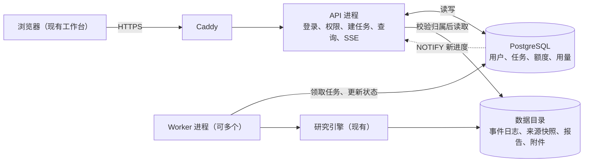

# 后端扩展设计方案

- 日期：2026-11-06
- 状态：已确认方向，按阶段实施；各阶段开工前把对应部分拆成 issue，挂在 GitHub 里程碑“后端扩展”下。
- 已定决定：[ADR 0001–0004](adr/README.md)。本文与 ADR 冲突时以 ADR 为准，并修正本文。
- 起草：Codex 初稿（任务状态、执行尝试、验收场景），Claude Code 按 ADR 与讨论结果合并修订（#9）。

## 1. 目标

把单人使用的研究工作台扩展成**支持异步研究、过程回放和证据追溯的多用户研究后台**，先面向邀请制内测。

两个目的并行：

- 产品上：内测用户能注册、拿免费额度体验，也能用自己的 key；研究不因关网页或服务重启而丢失。
- 学习上：每个阶段对应一类后端能力（分层、数据库、事务与并发、异步任务、事件流、缓存、可观测性），能讲清为什么这样做。

研究引擎（检索、阅读、子 Agent、存证、交稿）的能力和证据引用合同保持不变。

## 2. 现状与问题

| 现在的做法 | 问题 | 位置 |
| --- | --- | --- |
| 研究在 Web 进程的后台线程里跑 | 服务重启，正在跑的研究中断 | `src/dra/web.py` `RunRegistry` |
| 实时进度存在进程内存 | 重启后无法续接进度，只能回放历史 | `web.py` `api_stream` |
| 启动时把未结束的运行标为失败 | “进程中断”和“执行出错”混在一起 | `src/dra/runstore.py` `mark_orphans` |
| 运行记录是本地文件（`runs/<id>/meta.json`、`events.jsonl`、报告） | 不能按用户查询、分页、统计 | `runstore.py` |
| 没有用户，靠 Caddy Basic Auth 一个密码 | 所有人共用历史、资料库和模型配置 | [deployment.md](deployment.md) |
| 全站同时最多 `DRA_MAX_ACTIVE_RUNS`（默认 1）个研究，超出直接拒绝 | 多人使用时频繁被拒；名额靠进程内的锁控制，开不了第二个进程 | `web.py` `_admission` |
| `web.py` 约 1900 行，路由、运行管理、存储调用写在一起 | 后续改动难以定位和测试 | `web.py` |

## 3. 目标架构

第一版是**模块化单体 + 两类进程**：代码在同一仓库，部署成 API 和 Worker 两个进程，同一台机器、共享数据目录。



| 部分 | 负责 |
| --- | --- |
| API | 身份与权限、建任务、查状态与结果、转交补充消息和取消请求、推送进度（SSE） |
| Worker | 领取任务、调用研究引擎、写进度和结果、记录用量与扣额度、响应取消 |
| 研究引擎 | 不变；不知道“用户”“额度”，需要的配置和回调由 Worker 传入 |
| PostgreSQL | 结构化数据和任务队列（ADR 0002） |
| 数据目录 | 大文件和事件日志，沿用现有格式 |

代码分层见 [开发规范 §1](开发规范.md#1-分层)。

## 4. 阶段路线

| 阶段 | 做什么 | 用户能感受到 | 后端能力 | issue |
| --- | --- | --- | --- | --- |
| 0. 拆代码 | `web.py` 拆成接口 / 业务 / 存储三层，行为不变 | 无变化 | 分层 | #8 |
| 1. 数据库 + 用户 | PostgreSQL、迁移工具；邀请码注册、登录；所有资源归属到用户并校验；旧数据导入 | 有账号，只看得到自己的研究 | 表设计、索引、权限、数据迁移 | 待拆 |
| 2. 额度 + 自带 key | 免费模型额度、搜索次数、用户 key 加密保存、服务商列表 | 看到剩余额度，可填自己的 key | 事务、并发扣减、安全 | 待拆 |
| 3. Worker + 进度跨进程 | 研究搬进 Worker；任务表排队；取消、中断识别、重复提交去重；进度经通知推送、断线续传 | 关网页、重启服务研究不丢；人多时排队 | 异步任务、状态机、故障恢复、事件流 | 待拆 |
| 4. Redis | 按人限流、搜索结果缓存（先写 ADR） | 重复搜索更快更省 | 缓存、限流 | 待拆 |
| 5. 可观测性 + 上线 | 结构化日志、指标；部署加入数据库和 Worker；备份；机器容量 | 管理员看得到运行状况和用量 | 监控、容量、运维 | 待拆 |

- **内测开放点：第 3 阶段完成后。** 之前同时只能跑 1 个研究，多人会被拒绝。
- 第 3 阶段的 Worker 和进度跨进程必须一起上线：研究搬到 Worker 后，API 进程看不到它内存里的进度。
- 本地开发从第 1 阶段起用 Docker Compose 跑 PostgreSQL；生产环境到第 5 阶段才变更。

## 5. 数据模型

表名和字段是设计意图，实现时以迁移脚本为准。所有时间用带时区的时间戳。

| 表 | 主要字段 | 说明 |
| --- | --- | --- |
| `users` | id、email（唯一）、password_hash、role（user / admin）、status、created_at | 密码只存哈希（argon2 或 bcrypt） |
| `invites` | code（唯一）、created_by、used_by、expires_at、used_at | 一码一用 |
| `sessions` | id、user_id、token_hash、expires_at、revoked_at | 登录会话，见 §6.1 |
| `conversations` | id、user_id、title、created_at | 索引 `(user_id, created_at)` |
| `research_tasks` | id、user_id、conversation_id、query、plan、config_snapshot、status、idempotency_key、cancel_requested_at、created_at | 用户的一次研究请求；唯一约束 `(user_id, idempotency_key)`；索引 `(status, created_at)` 供领取 |
| `run_attempts` | id、task_id、run_id、worker_id、status、heartbeat_at、started_at、finished_at、error、last_event_seq | 每次实际执行；`run_id` 对应数据目录 `runs/<run_id>/` |
| `artifacts` | id、attempt_id、kind、path、sha256、size、created_at | 报告、附件的位置和哈希 |
| `library_documents` | id、user_id、name、current_version、created_at | 私域资料归属；正文仍在资料库目录 |
| `quotas` | user_id、kind（model_tokens / searches）、limit、used、period_start | 唯一 `(user_id, kind, period_start)` |
| `usage_records` | id、attempt_id、user_id、kind、provider、model、input_tokens、output_tokens、searches、key_source（platform / own）、call_key、created_at | 每次模型或搜索调用一条；唯一 `call_key` 防重复记账 |
| `user_provider_keys` | id、user_id、provider、ciphertext、last4、created_at、disabled_at | 用户自带 key，加密保存（ADR 0003/0004） |

迁移旧数据：现有 `runs/` 记录全部归到一个管理员账号，保留原 `run_id`、会话链、来源和证据编号；不会默认对其他用户可见。

## 6. 核心设计

### 6.1 登录与权限

- 注册需要邀请码；管理员在后台生成。
- 登录建议用 **服务端会话 + HttpOnly Cookie**：前端和接口同域，Cookie 不被页面脚本读取，会话可随时吊销。JWT 适合跨域或多服务场景，这里不需要。最终在第 1 阶段开工时写成 ADR。
- 归属校验覆盖所有按 ID 访问的接口：研究详情、事件回放与 SSE、来源原文、图片、附件下载与预览、执行日志、上下文检查点、资料库文档、追问、补充消息、取消。访问他人资源返回 404（不暴露是否存在）。
- 全局配置变为**仅管理员**可改：模型连接（`/api/providers`、`/api/config`、`/api/model-catalog`）、外部资料服务（`/api/mcp`）、技能（`/api/skills`）。普通用户只管理自己的 key。
- 任务创建时保存 `config_snapshot`，之后管理员改配置不影响已排队或运行中的任务。

### 6.2 额度与自带 key（ADR 0003、0004）

**免费模型额度**：只允许平台指定的一个模型，按 token 计。

- 每次模型调用前：剩余额度 ≤ 0 则不发请求，进入交稿（见下）。
- 调用后：按服务商返回的实际用量原子累加：

  ```sql
  UPDATE quotas SET used = used + :tokens
  WHERE user_id = :uid AND kind = 'model_tokens' AND period_start = :p;
  ```

  同时写 `usage_records`，`call_key = attempt_id + 调用序号`，重试时同一调用不会记两次。
- 因为单次调用的用量事先未知，同一用户并发研究时可能**略微超出**上限，超出量不超过同时进行中的调用各一次。这是有意的取舍：预扣估算会让额度显示不准、实现更复杂。
- 免费模型必须选会返回用量的服务商（`src/dra/llm.py` 中部分中转不返回用量，这类服务商不能用于免费额度）。

**额度用完时交稿**：复用现有“只允许交稿”的收尾回合（`SimpleConfig.reserve_wrapup_calls`，见提交 2381395）。额度检查作为回调由 Worker 传入研究引擎，引擎只知道“该收尾了”，不知道额度概念。前端显示“免费额度已用完，已用现有材料交稿”。

**搜索次数**：次数事先已知，用条件更新先扣后搜：

```sql
UPDATE quotas SET used = used + 1
WHERE user_id = :uid AND kind = 'searches' AND period_start = :p AND used < "limit"
RETURNING used;
```

没有返回行即额度用完，搜索工具向模型返回“搜索额度已用完”，研究继续用已有材料。所有用户都扣，与是否自带模型 key 无关。

**用户自带 key**：

- 只能从平台维护的服务商列表选择，Base URL 由平台决定（ADR 0004）。
- 用应用级主密钥（环境变量，如 `DRA_KEY_ENCRYPTION_KEY`）加密后存库，接口和页面只返回 `last4`；日志、事件、错误信息里不出现明文。
- key 失效或余额不足时，把服务商错误告诉用户，不改用平台 key。
- 用自带 key 不扣模型额度，只记 `usage_records`（`key_source = own`）供用户查看 token 用量。

### 6.3 任务生命周期

| 状态 | 含义 |
| --- | --- |
| `queued` | 已接受，等待执行 |
| `running` | Worker 正在执行 |
| `cancelling` | 用户已请求取消，Worker 尚未确认退出 |
| `succeeded` | 执行结束，结果已提交 |
| `failed` | 因明确错误结束 |
| `cancelled` | Worker 确认取消并结束 |
| `interrupted` | 执行进程失联，未正常结算 |

这些是**平台执行状态**。现有的交付状态、覆盖情况、停止原因（`simple.json` 四项状态）继续独立保留；“执行成功”不等于“报告完整”或“结论正确”。

**提交**：前端每次提交生成一个 `idempotency_key`。同一 key 重试返回已有任务；用户主动再问相同问题会生成新 key，创建新任务。

**领取**：

```sql
-- 短事务，只做领取
SELECT id FROM research_tasks
WHERE status = 'queued' ORDER BY created_at
FOR UPDATE SKIP LOCKED LIMIT 1;
-- 同一事务内：任务改 running，插入 run_attempts（worker_id、heartbeat_at），提交
```

研究在事务外执行。Worker 并发数由配置决定，替代现在的全站 `DRA_MAX_ACTIVE_RUNS`。

**心跳与中断**：Worker 定期更新 `heartbeat_at`。超过阈值未更新的 `running` 尝试标为 `interrupted`，已提交的证据和文件保留。不会自动重跑：外部模型和搜索调用无法保证只执行一次、只计费一次。用户可手动“重新执行”，生成新的 `run_attempts` 和新 `run_id`，旧记录可追溯。

**取消**：API 写 `cancel_requested_at` 并把状态改 `cancelling`；Worker 轮询或收到通知后，触发现有研究取消机制；引擎真正退出后才写 `cancelled`，并释放并发名额（沿用现在“线程退出才释放名额”的规则）。

**完成与取消同时发生**：终态写入都带条件，先提交者生效：

```sql
UPDATE research_tasks SET status = :final
WHERE id = :id AND status IN ('running', 'cancelling');
```

规则：结果已完整提交的，即使随后收到取消也记为 `succeeded`；取消确认在结果提交之前的，记为 `cancelled`。用并发测试覆盖。

**断点续跑不在本期**：需要保存主子 Agent 消息、待执行工具位置、预算、引用候选等完整检查点，现有事件日志不能代替，见 [EXPERIMENT_PLAN 暂停与断点恢复评估](../EXPERIMENT_PLAN.md#暂停与断点恢复评估2026-09-26建议未实施)。

### 6.4 进度事件与推送

事件规模（本机 49 份事件日志实测）：单次研究中位 2.7 MB，90% 在 17 MB 以内，最大 21 MB、约 4 万条。

**建议（第 3 阶段开工时写成 ADR）：事件正文继续写数据目录的 `events.jsonl`，数据库只记进度位置，用 PostgreSQL 通知推送。**

1. Worker 按现有格式追加事件到 `runs/<run_id>/events.jsonl`（沿用 `seq` 和事件 schema 版本），每批写完后更新 `run_attempts.last_event_seq`，并 `NOTIFY run_events, '<attempt_id>:<seq>'`。
2. API 启动时 `LISTEN run_events`。SSE 连接带上最后收到的序号（`Last-Event-ID` 头或查询参数），API 先从文件补发之后的事件，再随通知继续读新增部分。
3. 客户端按 `run_id + seq` 去重（现有前端已按 seq 去重）。
4. API 重启后，客户端重连即可从断点续接，不需要恢复进程内存。

理由：事件体量大，全部入库会让数据库膨胀，且要改写现有回放；文件 + 通知改动最小，历史回放接口不变。代价：API 和 Worker 必须共享数据目录，即只能单机部署；以后跨机器时，把事件存储换成数据库或对象存储，接口不变。

备选：事件全部写入 `run_events` 表（批量提交）。跨机器更简单，但存储和写入压力大。

### 6.5 文件存储

- 来源快照、报告、附件、执行产物继续存数据目录，路径和哈希登记在 `artifacts`。
- 所有文件访问先查归属，再读文件。
- 私域资料库按用户隔离目录；索引沿用现有实现。

### 6.6 可观测性

- 结构化日志，每条带 `user_id`、`task_id`、`attempt_id`、`run_id`。
- 指标：排队数、运行数、排队耗时、单次研究耗时、模型延迟与失败率、搜索失败率、额度用尽次数。
- 现有 `call_journal`、`llm_observation`、`search_observation` 的数据接入指标。
- 能回答：一次研究的时间花在排队、模型、搜索还是工具上；哪个调用失败、有没有重试；用了多少 token；取消到真正退出花了多久。

## 7. 接口变化

**新增**

| 接口 | 说明 |
| --- | --- |
| `POST /api/auth/register` | 邀请码 + 邮箱 + 密码 |
| `POST /api/auth/login`、`POST /api/auth/logout` | 会话 Cookie |
| `GET /api/me` | 当前用户、角色、额度剩余 |
| `GET /api/me/usage` | 自己的用量记录 |
| `GET/POST/DELETE /api/me/keys` | 自带 key，返回只含 `last4` |
| `GET /api/providers/allowed` | 用户可选的服务商列表 |
| `POST /api/research/{task_id}/retry` | 中断或失败后重新执行 |
| `GET/POST /api/admin/invites` | 生成、查看邀请码 |
| `GET/PATCH /api/admin/users` | 用户列表、调额度、停用 |

**变化**

- `POST /api/research`：接受 `idempotency_key`；返回 `202` 和任务 ID，状态 `queued`。额度为零且没有自带 key 时拒绝并说明原因。
- `GET /api/research/{id}/stream`：支持从指定序号续接；任务不在内存也能订阅。
- `GET /api/runs`、`/api/conversations`、`/api/library`：只返回当前用户的数据，支持分页。
- 所有按 ID 访问的接口：增加归属校验（§6.1）。
- 全局配置接口：仅管理员。

## 8. 前端变化

- 登录、注册（邀请码）页面。
- 顶部显示剩余免费额度和搜索次数。
- 研究列表显示“排队中 / 运行中 / 取消中 / 已中断”，中断的可“重新执行”。
- 设置页：普通用户只看到“我的 key”；管理员保留现有模型、技能、外部资料配置。
- 管理员页：邀请码、用户、用量。

## 9. 部署

- Compose 增加 `postgres` 和 `worker` 服务；API 和 Worker 使用同一镜像、不同启动命令，共享 `/data`。
- 数据库迁移在发布流程里、切换新版本前执行；迁移只增不改（[开发规范 §3](开发规范.md#3-数据库引入后生效)）。
- 每日 `pg_dump` 备份，保留策略上线前定。
- **容量**：线上机器 1.9 GB 内存，目前已关闭浏览器和运行代码功能。加 PostgreSQL 和 Worker 前需实测内存，大概率需要升级机器或改用托管数据库。
- 线上运行代码、浏览器功能在多用户模式下**暂不开放**：现有隔离按单人使用设计，开放前需重新设计（§11）。

## 10. 验收场景

| 场景 | 预期 |
| --- | --- |
| 同一提交重复发送（同一 `idempotency_key`） | 只创建一个任务，返回同一任务 ID |
| 用户主动再问相同问题 | 创建新任务 |
| 两个 Worker 并发领取 | 同一任务只被领取一次 |
| 重启 API | Worker 继续执行；客户端重连后续接进度 |
| SSE 中途断线 | 从最后序号补发，不重复、不遗漏 |
| 请求取消 | 先显示取消中，引擎退出后变为已取消，名额此时才释放 |
| 取消与完成同时发生 | 按 §6.3 规则得到一致终态 |
| Worker 被强制终止 | 心跳超时后标为已中断，已存材料保留 |
| 重新执行中断任务 | 新执行记录和新 `run_id`，旧记录可查 |
| 访问他人研究、事件、文件、资料 | 一律 404 |
| 普通用户改全局配置 | 403 |
| 免费额度在研究中途用完 | 不再调用模型，用已有材料交稿并提示原因 |
| 同一用户两个研究并发扣额度 | 累计用量正确；超出不超过各自一次进行中的调用 |
| 搜索次数用完 | 搜索返回额度用完，研究继续 |
| 自带 key 失效 | 提示 key 问题，不使用平台 key |
| 接口、日志、事件中查找用户 key | 只出现 `last4` |
| 旧数据导入后 | 来源、证据引用、报告、附件、会话关系可核对，且只对管理员可见 |

性能测试使用离线研究替身，记录提交延迟、排队耗时、并发执行数、事件补发耗时和错误率，附测试环境与负载。离线结果不代表真实模型质量；真实模型研究质量另行验收。

## 11. 本期不做

- Kafka、RabbitMQ、微服务、gRPC、K8s、分库分表：量级用不上（ADR 0002）。
- 团队、共享、协作。
- 断点续跑（§6.3）。
- 按金额计费、充值：内测只按 token 和次数（ADR 0003）。
- 多用户下的运行代码与浏览器：现有执行环境、HTML/SVG 预览和浏览器扩展按单人使用设计，开放给不可信用户需另行设计隔离（参见 [技能与执行环境设计待办](技能与执行环境设计待办.md)）。
- 跨机器部署（§6.4 代价）。

## 12. 待定事项

| 事项 | 何时定 | 当前倾向 |
| --- | --- | --- |
| 登录方式 | 第 1 阶段开工 | 服务端会话 + HttpOnly Cookie |
| 免费额度数值、搜索次数上限、额度周期 | 第 2 阶段上线前，由用户定 | — |
| 免费额度用哪个模型、哪家服务商 | 第 2 阶段 | 返回用量的便宜模型 |
| 事件存储与推送 | 第 3 阶段开工 | 文件 + `LISTEN/NOTIFY`（§6.4） |
| 心跳间隔与中断判定阈值 | 第 3 阶段 | 实测后定 |
| Redis 的具体用途 | 第 4 阶段，先写 ADR | 限流、搜索缓存 |
| 线上机器升级或托管数据库 | 第 5 阶段前 | 实测内存后定 |

## 13. 新增的限制

本方案引入、实施时需在对应 PR 中再次列出的限制：

- 注册需要邀请码（ADR 0003）。
- 免费额度只能用一个模型；搜索有次数上限（ADR 0003）。
- 用户自带 key 只能选列表内服务商（ADR 0004）。
- 普通用户不能修改全局模型、技能、外部资料配置。
- 多用户模式下暂不开放运行代码和浏览器功能。
- 同一用户并发研究时，模型额度可能小幅超出上限（§6.2）。
- 第一版只能单机部署（§6.4）。

全站并发上限 `DRA_MAX_ACTIVE_RUNS` 将被 Worker 并发数取代，超出时由“拒绝”改为“排队”。
