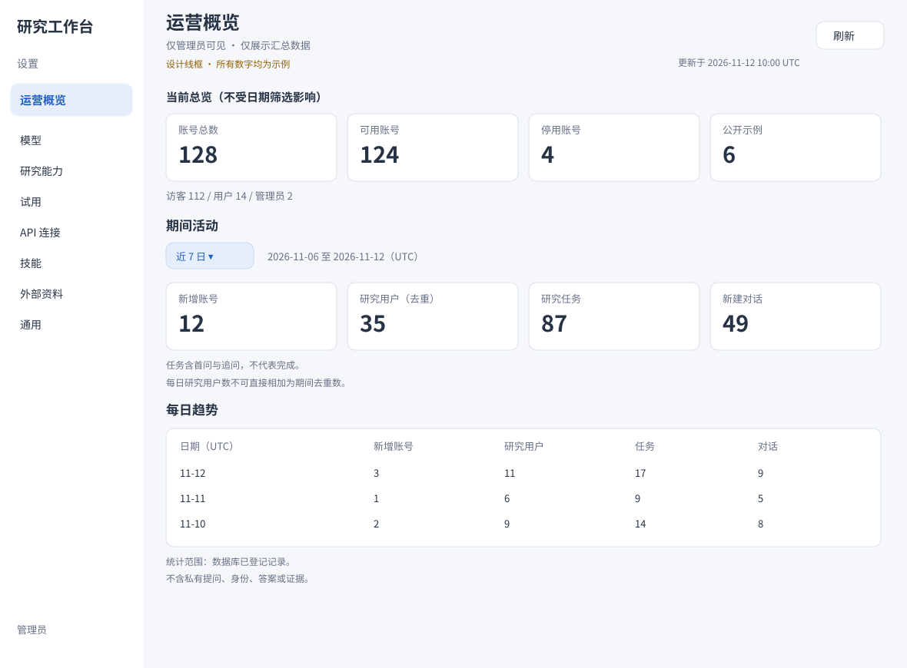
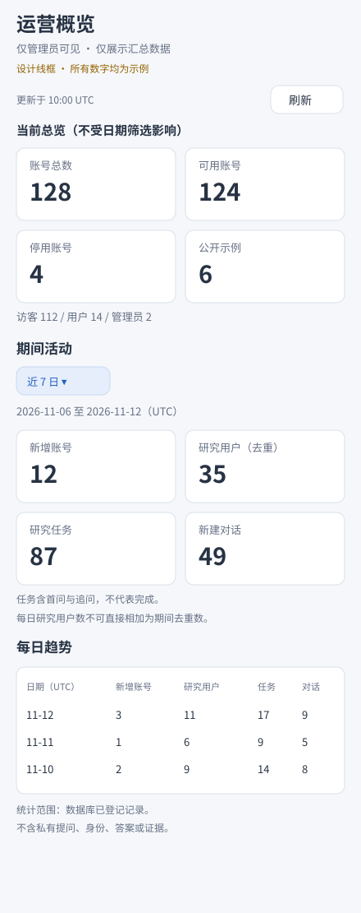

# 管理员运营维护面板

- 状态：已接受（设计 PR #61 已合并；实现见 #62，待代码 PR 合并）
- 日期：2026-11-12
- 作者：Codex
- 关联：[#60](https://github.com/yy2511/deep-research-agent/issues/60)、[ADR 0008](../adr/0008-admin-aggregate-dashboard.md)
- 核对基线：`cbcd565`。以下接口和组件名称标为“新增”的均为拟议内容，不是现有能力。

## 目标与不做什么

给管理员一个只读的全站概览：多少账号、最近多少人发起研究、多少研究和对话、已有多少公开示例。所有展示均为汇总计数，不含个人身份或私有研究内容。“可公开信息”在本方案中指可用于汇总展示的信息，不表示允许匿名访问：面板和统计 API 均仅管理员可见。

本期不做用户名单、邮箱/GitHub 身份、提问全文/关键词/主题、答案、证据、每人排行、私有研究链接、数据导出、账号操作或数据删除。不采集新的浏览事件，不加第三方分析服务。不把“账号可用”称为活跃用户，不把登录会话称为研究对话。不展示缺乏可靠结构化来源的在线人数、成功率、失败率、运行队列、Token、费用、磁盘/备份健康度。

设计已由 PR #61 合并接受；实现跟踪 #62，不扩大私有研究读取权限。

## 现状与依据

- [db_tables.py](../../src/dra/db_tables.py)：`User` 有角色、可用/停用状态及创建时间；`Conversation` 表示研究对话；`ResearchTask` 每条为首问或追问；`RunAttempt` 为执行登记；`Showcase` 为公开示例。当前运行状态在文件中，不在这些表中。
- [run_records.py](../../src/dra/api/services/run_records.py)：`reserve_new_run`、`reserve_followup` 登记研究；`release` 撤销未启动成功的占位；`import_legacy` 导入历史。因此“研究任务数”是当前已登记的记录数，不等于 HTTP 提交次数或成功完成数。
- [deps.py](../../src/dra/api/deps.py)：`require_admin` / `ADMIN_ONLY` 已提供管理员检查；`readable_run` / `readable_conversation` 不给管理员跨用户读研究的豁免。本方案不改这两个读取检查。
- [App.tsx](../../web/src/App.tsx) 的 `page` 和 [SettingsPage.tsx](../../web/src/components/SettingsPage.tsx) 的 `SettingsTab` 提供设置导航；现有研究状态在 App 中持有，切换设置页不停止研究。
- `DailyCounter` 是访客配额计数，不是全站任务流水；`LoginSession.last_seen_at` 的更新不适合统计实时在线人数。本方案不使用两者冒充运营活动。

## 界面与交互

在管理员设置页增加独立“运营概览”标签，普通用户和公开示例模式均不显示，也不发送统计请求。使用现有颜色、字体、卡片和按钮，不引入图表依赖。





1. 标题：“运营概览”，副标题：“仅管理员可见 · 仅展示汇总数据”。右侧手动“刷新”，显示最近成功获取时间和 UTC 标签。不自动轮询。
2. **当前总览**：账号总数、可用账号、停用账号、公开示例数。可用/停用是账号状态，不是最近是否研究；三种角色的计数用一行“访客 / 用户 / 管理员”展示。明确这些卡片不受日期筛选影响。
3. **时间范围**：今日、近 7 日、近 30 日、全部、自定义起止日期。默认近 7 日，日期基于 UTC；预设只是快捷入口，不是支持范围上限。全部从最早的 User / Conversation / ResearchTask 创建日期起算；空库从今日起算。
4. **期间活动**：新增账号、研究用户数、研究任务数、新建对话数。下方说明“研究用户 = 期间至少登记一条研究的去重账号；任务含首问和追问，不代表完成”。不显示成功率或伪精确增长率。
5. **每日趋势表**：日期、新增账号、研究用户、研究任务、新建对话。默认日期倒序，含零活动日；语义化表格，有表头和说明。期间去重研究用户不能用每日去重值相加，界面须明确这一点。
6. 桌面卡片四列；窄屏改两列，日期和刷新控件换行；趋势表可横向滚动，标签和数值不截断。键盘可操作、焦点可见、加载/错误提示使用适当 live region。线框为结构参考，非完成的产品截图。
7. 离开标签或登出时取消请求并清空统计内存；不写 localStorage，不留存响应到第三方监测。返回研究页不取消研究、重置选中轮次或改变现有 `?run=` URL；沿用设置页导航，不新增路由框架。前进/后退继续遵循现有研究导航行为，不伪造未实现的面板深链接。

## 指标口径

所有计数针对同一数据库快照中现存记录。包含 guest / user / admin 与已停用账号，角色/状态分组为当前状态，不还原历史角色。公开示例已在研究表中，不重复相加；未导入数据库的旧文件不计入。不提供角色、用户、提问等细分筛选，以免变相下钻个人活动。

| 展示 / 响应字段 | 数据与算法 | 时间语义 |
| --- | --- | --- |
| 账号总数 / `totals.users` | `COUNT(User.id)` | 当前全部 |
| 可用账号 / `totals.enabled_users` | `User.status = active` | 当前全部；不是活跃用户 |
| 停用账号 / `totals.disabled_users` | `User.status = disabled` | 当前全部 |
| 角色分布 / `totals.roles` | 按当前 `User.role` 分组计数 | 当前全部；零值也返回 |
| 公开示例 / `totals.showcases` | `COUNT(Showcase.conversation_id)` | 当前全部 |
| 新增账号 / `period.new_users` | `User.created_at` 落入范围的计数 | 创建时刻 |
| 研究用户 / `period.research_users` | 范围内 `COUNT(DISTINCT ResearchTask.user_id)` | 数据库 created_at；导入时间规则见下文 |
| 研究任务 / `period.research_tasks` | 范围内 `COUNT(ResearchTask.id)` | 数据库 created_at；首问和每次追问分别计 1，不是每条聊天消息 |
| 新建对话 / `period.conversations` | 范围内 `COUNT(Conversation.id)` | 数据库 created_at（导入沿用历史开始时间）；旧对话的新追问不增加此数 |
| `daily` | 按 UTC 日聚合同上四项，再补零活动日 | 日去重与期间去重独立计算 |

HTTP 校验失败、额度拒绝及成功撤销的启动占位不产生可计数任务；补偿失败留下的登记会计入。这不是审计/计费台账。`import_legacy` 把旧记录归到指定管理员，`created_at` 优先沿用旧运行开始时间，缺失时采用导入时刻，因此历史日期和研究用户数反映导入归属而非原始访客身份。导入、手动删除会改变计数；不把“今天新增记录”解释为“今天实际访问/成功完成”。响应 `scope` 固定为 `registered_database_records`，UI 持续显示此口径说明。

## 接口与分层

新增 `GET /api/admin/operations`，挂 `ADMIN_ONLY`，使用现有 HttpOnly 登录 Cookie 与数据库就绪检查。不复用公开示例路由。响应显式建模，只允许下述汇总字段，禁止直接序列化 ORM 对象或私有研究元数据。

参数：

- `start_date`、`end_date`：ISO `YYYY-MM-DD`，两者同时提供或同时省略；省略代表含今日在内近 7 个 UTC 自然日。
- `all_time=true`：与日期参数互斥。返回服务端计算的真实开始/结束日期。默认 false。
- 日期包含两端，在 SQL 转为 `[start_date 00:00 UTC, end_date + 1 day 00:00 UTC)`，今日只计请求时已提交的数据。`end_date` 不得超过服务器 UTC 今日，开始不能晚于结束；无有效范围返回 400。对无法转换为下一日的日期返回 400，不截断。
- 不添加任意 30/90 天硬上限或静默抽样。未来若数据量需要限制，单独评估并明确告知。

示例（模拟值，非线上观测）：

```json
{
  "as_of": "2026-11-12T10:00:00Z",
  "timezone": "UTC",
  "scope": "registered_database_records",
  "range": {"start_date": "2026-11-06", "end_date": "2026-11-12"},
  "totals": {"users": 128, "enabled_users": 124, "disabled_users": 4,
    "roles": {"guest": 112, "user": 14, "admin": 2}, "showcases": 6},
  "period": {"new_users": 12, "research_users": 35, "research_tasks": 87, "conversations": 49},
  "daily": [
    {"date": "2026-11-06", "new_users": 2, "research_users": 8, "research_tasks": 13, "conversations": 7},
    {"date": "2026-11-07", "new_users": 1, "research_users": 7, "research_tasks": 11, "conversations": 6},
    {"date": "2026-11-08", "new_users": 0, "research_users": 4, "research_tasks": 6, "conversations": 4},
    {"date": "2026-11-09", "new_users": 3, "research_users": 10, "research_tasks": 17, "conversations": 10},
    {"date": "2026-11-10", "new_users": 2, "research_users": 9, "research_tasks": 14, "conversations": 8},
    {"date": "2026-11-11", "new_users": 1, "research_users": 6, "research_tasks": 9, "conversations": 5},
    {"date": "2026-11-12", "new_users": 3, "research_users": 11, "research_tasks": 17, "conversations": 9}
  ]
}
```

`daily` 按日期升序返回且覆盖每个自然日；UI 可倒序呈现。上述每日可加指标之和等于 `period` 对应字段；每日研究用户数之和 55 不等于期间去重 35。同一请求的 `totals` 与 `period` 时间作用域不同，不能相互误比。

拟议代码落点：

- `api/routers/operations.py`：使用普通同步 `def` 路由，由 FastAPI 在线程池执行；负责权限、参数解析、响应模型与 `Cache-Control: no-store`，通过 `service_errors()` 翻译错误。标准字段校验使用项目 FastAPI/Pydantic 机制（格式错误 422）；成对日期、互斥或范围语义错误由业务层 `InvalidRequest` 返回 400。
- `api/services/operations.py`：日期口径、聚合结果编排、补零、返回纯数据；不依赖 FastAPI。
- `api/repositories/operations.py`：新增存储层模块，SQLAlchemy 只做 COUNT、DISTINCT、GROUP BY、MIN；不 SELECT `query`、邮箱、身份信息、session token，也不访问运行文件。复用 `Database`，不得让路由直接操作数据库。
- `api/app.py`：注册管理员路由；`web/src/components/OperationsDashboard.tsx`、配套类型及测试：独立读取和展示，不串用研究列表 API。

无新表、迁移、依赖、后台任务或外部服务。日期聚合采用 PostgreSQL/SQLite 各自明确的 UTC 日期表达式，测试必须验证一致口径。短只读事务采用 PostgreSQL `REPEATABLE READ` 获取一致快照（在首条 SQL/事务开始前设置，仅此查询连接，不改全局隔离级别），`as_of` 为快照取得时刻；SQLite 离线使用一致读事务验证聚合逻辑。跨引擎时区/隔离差异不能只靠 SQLite 通过来声称 PostgreSQL 已验证。

首次实现先用现有索引与数据库聚合，禁止 N+1 扫描用户/目录。全量日期范围的查询/响应随数据和跨度增长，需在实现时用合成数据测量查询次数、耗时和内存；若不能满足合理交互性能，回到设计评审索引/预聚合，而不是偷偷截断。性能目标须依据实际部署预算另定，当前没有生产基准数据。

## 权限与隐私

- 匿名/过期登录按现有规则 401；非管理员 403；停用管理员按 `resolve_session` 现有行为拒绝。每次请求重验，不能只隐藏菜单。
- 不改现有 `owned_*` / `readable_*`。管理员仍不能借本面板打开他人私有研究。
- 不返回任何 user/task/run/conversation ID 或个人列表；日志也不记录完整响应、SQL 参数中的身份或研究内容。仅记录请求成功/失败及耗时等运维摘要。
- 汇总仍可能在小样本下泄露参与情况，不能宣称匿名化保证或开放到公众。限制在现有管理员信任边界内，无身份筛选/下钻；未来扩大访问范围需另行隐私评审。
- `no-store`，前端不持久化统计；登出/角色降级返回 401/403 时立即清空已有统计，不显示旧缓存。网络失败时可保留同一范围的旧快照，但必须显著标注“刷新失败，以下为旧数据”及原时间；换范围失败不得用旧范围数字冒充新数据。

## 出错时怎么办

- 首次加载显示骨架/“加载中”，不先显示 0。空库是成功响应的全零与补零日期，不等同不可用。
- 数据库不可用/查询失败统一安全 503 文案“运营统计暂不可用，请稍后重试”，不回传 SQL/连接串；不会用目录扫描或缓存伪装成功。
- 请求中禁用重复刷新；改范围或离开时 AbortController 取消旧请求，并用请求序号阻止晚到结果覆盖新状态。A→B→A 也验证请求序号，而不是只比较日期。
- 同次响应失败不展示半套新数据；跨两次刷新因有新记录而变化正常。没有写操作，不触发配额消耗或研究执行。

## 验收场景（执行情况见实施记录及实现 PR）

| 场景 | 预期 |
| --- | --- |
| 匿名、过期、guest、user、停用管理员直接访问 API | 按现有鉴权语义拒绝；返回体不含计数 |
| 管理员访问；后续降级/登出 | 可读汇总；下一请求拒绝，UI 清空统计 |
| 管理员访问他人私有 run/conversation | 继续 404，无权限扩大 |
| 隐私诱饵：query/email/身份/ID 含独特字符串 | API schema 和序列化响应无这些字段/字符串；无文件扫描 |
| 空库 / 无活动日期 / 角色计数为零 | 真实 0、日期补齐，不报错、不丢列 |
| 同一人多次研究、跨日研究、旧对话追问 | 任务逐条计，期间用户去重，新对话不重复计 |
| 首问占位撤销、配额拒绝、未登记目录 | 计数遵循数据库记录口径；未登记文件不计 |
| 历史运行跨日导入、旧时间缺失、导入归属管理员 | 按旧 started_at 回填日期；缺失/非正时间用导入时刻，用户按数据库归属去重，不虚构原访问者 |
| UTC 日边界、闰日、不同浏览器时区、今日未结束 | 半开区间准确；UI 标签明确 UTC |
| 缺一端、范围倒置、未来日期、all_time 混用、格式错误 | 语义错误 400、格式错误 422；不暗中纠正 |
| 近 7 日与全部/自定义 | 范围正确、无任意天数上限；当前总览不随筛选改变 |
| 并发写入期间统计 | 单次响应一致快照；不同次可更新，禁止半套结果 |
| 慢请求 A→B→A、重复刷新、离开设置、前进后退 | 新请求胜出；离开后不提交；研究流和轮次保持 |
| 首次失败 / 同范围刷新失败 / 换范围失败 | 错误、旧快照标识与范围一致；不把失败显示成零 |
| 移动端、键盘、读屏、长数字 | 可操作可读，表格可滚动，错误不只靠颜色 |

实现验证命令：`uv run pytest`、`uvx ruff@0.17.3 check --select E9,F63,F7,F82 .`、`npm --prefix web test`、`npm --prefix web run lint`、`npm --prefix web run build`。新增后端聚合/权限测试、前端导航/状态测试，保留现有研究访问回归。PostgreSQL 集成、真实浏览器、Docker 或生产验证遵循仓库另行授权要求，未跑必须披露。设计 PR #61 仅检查了文档与线框；实现阶段的实际验证和未验证部分见下方实施记录及代码 PR，不将离线测试称为真实模型或生产验收。

## 新增的限制

运行系统无变化。本设计拟新增管理员专用汇总入口，保持研究所有权隔离；首版仅数据库登记指标、不含查询全文与运行健康指标，属于明确范围而非静默降级。UTC 是统计展示口径，与可配置的试用额度日界分开，不改变额度、保留期限、研究次数/大小限制。

## 待定事项

| 事项 | 何时定 | 当前倾向 |
| --- | --- | --- |
| 实现评审与部署 | 实现 PR 合并后，由维护者决定部署 | 设计 PR #61 已合并，用户已授权实现；不直接部署 |
| 生产性能预算、是否需新增时间索引 | 实现时合成数据测量后 | 无证据先不加索引；若加用新迁移 |
| 成功率/耗时/资源健康 | 后续需求提出时 | 先有结构化可信状态源及权限设计，不扫私有报告充数 |

## 实施记录

实现跟踪 [#62](https://github.com/yy2511/deep-research-agent/issues/62)，代码 PR 待评审/合并。

- 已新增 `api/repositories/operations.py`、`api/services/operations.py`、`api/routers/operations.py`，在 `app.py` 注册管理员专用只读接口；无新表或依赖。
- 设置页新增 `OperationsDashboard.tsx`，请求与取消/竞态逻辑位于 `web/src/operations.ts`。日期快捷入口、手动刷新、旧快照错误标识、权限失效清空、移动布局按上文实施。当前总览与期间指标保持分开。
- 服务端当前日期来自同一数据库快照；补零在数据库事务关闭后进行。格式错误 422、日期组合/范围语义错误 400，响应显式建模并设置 `no-store`。
- 已补充真实 Cookie 权限、角色变化、私有研究隔离、闰日/UTC 偏移、历史导入/撤销、只读查询与并发快照测试，以及前端请求竞态和静态渲染测试。
- 离线合成 SQLite 性能测量（2026-11-12，当前云开发环境，单次）：10,000 账号、10,000 对话、50,000 研究任务，30 日查询共 10 条 SQL，0.092 秒，Python tracemalloc 峰值 0.47 MiB。不是生产 PostgreSQL 基准，不作为性能承诺。
- 真实 PostgreSQL、Docker、真实模型和生产环境未验证。用户授权后尝试本地浏览器验收，但 Chromium 启动报 `socket() Operation not permitted`，受支持的云浏览器也无法连接本机服务，未打开测试页面，未获得真实截图；不能把离线组件测试称为浏览器通过。线框和示例仍为合成数据。
- 新增可重复的显式浏览器验收：先 `npm --prefix web run build`，再 `DRA_DATA_DIR="$(mktemp -d)" uv run pytest -q tests/test_operations_browser.py --run-browser`。使用临时 SQLite、合成账号和本机 HTTP 服务，拒绝外部请求；默认 pytest 跳过此项。`DRA_BROWSER_EXECUTABLE` 可指定已有 Chromium，`DRA_OPERATIONS_SCREENSHOTS` 可指定截图输出目录。
- 无已接受设计的实质偏离；不新增时间范围硬上限、抽样或私有数据下钻。
