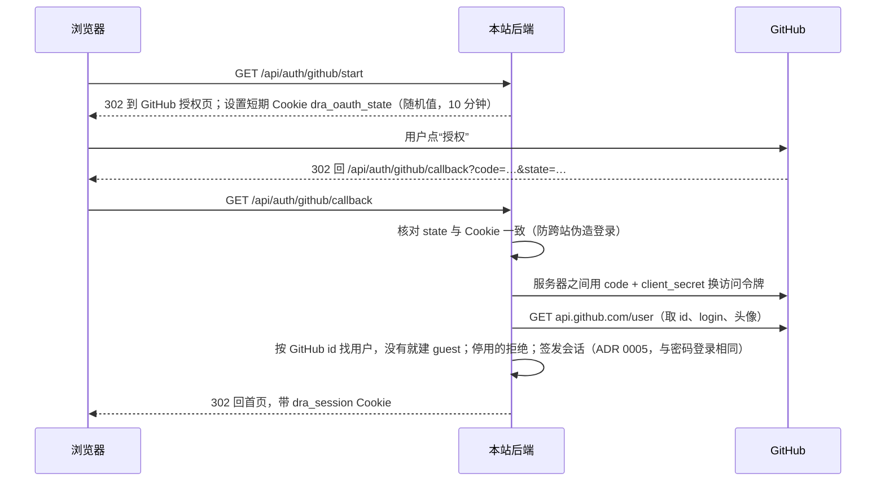

# 阶段 2：公开试用

- 状态：已接受（合并即接受）
- 日期：2026-11-08
- 作者：Claude Code
- 关联：#43、[ADR 0007](../adr/0007-public-trial-github-login.md)（取代 ADR 0003、0004）、[后端扩展总体方案](后端扩展总体方案.md)、[阶段1-数据库与用户](阶段1-数据库与用户.md)

## 目标与不做什么

**目标**：README 里放一个在线体验链接，从 GitHub 来的访客能：

1. 不登录就看到几个已经跑完的研究示例（完整过程回放 + 带引用的报告）。
2. 用 GitHub 一键登录，问一个自己的问题，看研究实时进行、拿到报告。
3. 在页面上点“提意见”，到仓库讨论区留言；想长期使用就按 README 在本机运行。

同时保证：费用每天有硬上限；访客碰不到运行代码、浏览器等对服务器有风险的功能；每个人只看得到自己的研究（第 1 阶段已实现）。

**不做**：

- 用户自带 key、按 token 的免费额度、充值（ADR 0007 取代了 ADR 0003、0004）。
- 自建留言、评论系统：反馈走 GitHub 讨论区。
- 研究排队：同时进行的研究满了就提示稍后再试；排队与后台进程是第 3 阶段。
- 管理员网页：示例、角色、次数调整先用管理命令。
- 给访客开放运行代码、浏览器、外部资料服务（MCP）、私域资料库、附件。

## 现状

- **账号**：`users` 表只有邮箱 + 密码一种登录方式，`email`、`password_hash` 都不能为空；角色只有 `user`、`admin`（`src/dra/db_tables.py` `User`）。注册必须有邀请码（`src/dra/api/services/auth.py` `register`）。
- **登录后**：每个请求经 `deps.current_user` 得到当前用户；带研究编号的接口按归属检查，别人的、不存在的都是 404（`deps.owned_run`、`owned_conversation`）。所有 `/api/*` 除健康检查和登录注册外都要求登录（`src/dra/api/app.py`）。
- **前端**：`AuthGate` 未登录时只显示登录页，看不到任何内容（`web/src/components/AuthGate.tsx`）。
- **研究配置**：所有人的研究都按管理员在设置页保存的配置跑（`runtime_config.current()`），包括模型、时间与调用上限、运行代码和浏览器开关。
- **并发**：全站同时最多 `DRA_MAX_ACTIVE_RUNS`（默认 1）个研究，满了直接拒绝（`src/dra/api/services/runs.py` `_MAX_ACTIVE_RUNS`）。
- **规划**：发起研究前的“澄清问题 / 生成计划”（`/api/brief*`）也会调用模型，现在没有次数限制。
- **线上**：仍是 2026-08 的旧版本，用 Caddy 一个共用密码保护；机器 1.9 GB 内存（[deployment.md](../deployment.md)）。

## 方案

### 1. 角色与试用限制

| 角色 | 怎么来 | 能做什么 |
| --- | --- | --- |
| `guest` | 第一次用 GitHub 登录时自动创建 | 看示例；按“试用设置”发起研究和追问，有每日次数限制；设置页只有“通用” |
| `user` | 邀请码注册（第 1 阶段） | 与现在相同：研究、资料库、技能等都可用，不限次数；不能改全站设置 |
| `admin` | `python -m dra.admin create-admin` | 全部 |

管理命令新增 `set-role --email|--github <登录名> --role guest|user|admin`，可以把熟人从 `guest` 升为 `user`。

**试用访客的研究**（服务端强制，不信任前端传来的选项）：

- 模型：用“试用设置”里指定的一个模型（服务商 + 模型名），规划和研究都用它；视觉兜底模型不用。
- 单次预算：“试用设置”里的时间上限、模型调用次数上限、工具调用次数上限，比管理员自己用的更紧。
- 资料来源：只允许 `source_mode = "web"`；`document_ids`、`mcp_server_ids` 必须为空。
- 关闭：运行代码、浏览器（不管全站设置怎么开）。
- 技能：只能选管理员已启用的技能（与现在相同），但因为运行代码关闭，需要运行脚本的技能步骤会如实报告不可用。
- 附件上传、资料库接口（`/api/library*`）：返回 403“试用账号不能使用资料库”。资料库要加载约 2 GB 的嵌入模型，线上机器承受不了。

请求里带了不允许的选项时返回 400，说明哪一项不可用，不静默改掉。

**试用设置**存在 `runtime_config.json` 新增的 `trial` 一节，管理员在设置页“试用”分页修改：

| 字段 | 含义 | 初始值（上线前由用户定） |
| --- | --- | --- |
| `provider`、`model` | 试用模型 | 未设置；未设置时访客发起研究返回 503“试用暂未开放” |
| `per_user_daily_runs` | 每个访客每天可发起的研究次数（追问也算） | 2 |
| `global_daily_runs` | 全部访客每天合计 | 20 |
| `per_user_daily_briefs` | 每个访客每天可调用规划接口的次数 | 10 |
| `global_daily_briefs` | 全部访客每天合计可调用规划接口的次数 | 100 |
| `max_concurrent_guest_runs` | 访客同时进行的研究最多几个（全站合计） | 2 |
| `wall_timeout_s`、`max_llm_calls`、`max_tool_calls` | 单次研究预算 | 实测后定 |

“一天”按 `Asia/Shanghai` 的 0 点切换，时区可在设置里改。

### 2. GitHub 登录

用 GitHub **OAuth App**（不是 GitHub App），只申请公开资料（`scope` 为空），不申请邮箱或仓库权限。

**配置**（环境变量，与数据库地址一样放 `.env` 或部署配置）：`DRA_GITHUB_CLIENT_ID`、`DRA_GITHUB_CLIENT_SECRET`。两个都没配时，登录页不显示 GitHub 按钮。

**流程**：



- GitHub 的访问令牌只用这一次，**不保存**。
- 按 GitHub 的数字 id 认人，不按登录名（登录名可以改）。登录名和头像每次登录时更新。
- `state` 不一致、用户在 GitHub 点了取消、GitHub 不可用：回到登录页并显示原因，不建账号。
- 已经用邮箱密码登录的人不需要绑定 GitHub；第 2 阶段不做账号合并。

### 3. 每日次数

**扣减时机**：发起研究和追问时，在第 1 阶段“先占位”的同一个数据库事务里扣（`run_records.reserve_new_run`、`reserve_followup`）。启动失败撤销占位时，把这次也退回；研究已经开始、之后失败或被取消的不退。

**原子扣减**（同一访客同时点两次、多个访客同时抢最后一个名额，都不会超）：

```sql
INSERT INTO daily_counters (scope, day, kind, count) VALUES (:scope, :day, :kind, 1)
ON CONFLICT (scope, day, kind) DO UPDATE SET count = daily_counters.count + 1
WHERE daily_counters.count < :limit
RETURNING count;
```

没有返回行就是用完了。先扣个人（`scope = 'user:<id>'`），再扣全站（`scope = 'guests'`），任一失败整个事务回滚。PostgreSQL 和 SQLite（3.35+）都支持这条语句。

**规划接口**：`/api/brief`、`/api/brief/plan`、`/api/brief/revise` 三个入口都会独立调用模型（`src/dra/api/services/planning.py`），各自在**调用模型之前**按 `kind = 'brief'` 扣次数：先扣个人（上限 `per_user_daily_briefs`），再扣全站（`scope = 'guests'`，上限 `global_daily_briefs`），同一个短事务，任一用完就返回 429，不调用模型。规划失败（模型报错、超时）不退次数。另外，当天研究次数已用完时规划也直接拒绝。这样只规划、不研究的访问也有全站硬上限，每天最坏的模型花费 = 全站研究次数 × 单次研究预算 + 全站规划次数 × 单次规划花费。

**同时进行**：访客同时只能有 1 个研究在跑；全部访客同时进行的研究不超过 `max_concurrent_guest_runs`。全站上限 `DRA_MAX_ACTIVE_RUNS` 线上改为比它大 1，给管理员留一个名额。名额满时返回 429“现在使用的人较多，请稍后再试”，不排队。

**用完时**：返回 429，说明是“你今天的次数用完了”还是“今天的试用名额用完了”，并附明天 0 点的时间；前端显示这段话，再加“可以先看看示例，或按 README 在本机运行”。

`GET /api/me` 增加 `trial`：`{runs_left, runs_limit, resets_at}`（非访客为 `null`），前端在提问框旁边显示“今天还可以问 1 次”。

### 4. 示例

管理员把自己已完成的**对话**（包括其中的追问）设为示例。

- **数据**：新表 `showcases`（`conversation_id` 主键并外键到 `conversations`、`title`、`sort_order`、`created_at`）。不复制研究文件，示例就是原来那份。
- **设为示例的条件**：对话属于管理员；每一轮都已结束，且没有已占位但还没结束的追问；每一轮都是纯网页研究（`source_mode = "web"`，没有选资料库和外部资料服务）。私域资料、外部服务的回执不能通过示例公开。命令会列出这些研究里有哪些附件、执行日志会一起公开，确认后才写入。
- **示例期间冻结**：对话设为示例后，后端拒绝任何人在其中追问，**包括原主人**，返回 409“该对话正作为示例展示，取消示例后才能追问”。检查放在 `run_records.reserve_followup` 的占位事务里，不靠前端隐藏追问框。`showcase add` 与 `reserve_followup` 都先锁住这个对话在 `conversations` 表里的行（`SELECT … FOR UPDATE`），两者同时发生时排队执行：要么先发布、追问被拒，要么先追问、发布时发现有未结束的轮次而拒绝。因此公开的内容始终是发布时确认过的那几轮，不会有后来的追问被自动公开。想继续追问：先 `showcase remove`，追问完再 `showcase add`，重新走一遍上面的条件检查。
- **管理命令**：`showcase add <conversation_id> --title …`、`showcase remove`、`showcase list`。网页上的“设为示例”按钮放到待定事项。
- **谁能看**：所有人，包括未登录。只读：追问、发消息、取消一律按第 1 阶段的规则返回 404。
- **接口**：
  - 新增 `GET /api/showcases`（不要求登录）：示例列表（标题、问题、完成时间、对话编号）。
  - 带研究编号 / 对话编号的接口分成两组：
    - **读取组**：查看研究、事件、来源、原件、图片、附件、执行日志、进度流、对话汇总、技能记录。检查改为 `readable_run` / `readable_conversation`：属于当前用户，或属于某个示例。属于示例时不要求登录。
    - **写入组**：追问、发消息、取消。仍用 `owned_run`，只有本人能操作；示例对话里的追问另被上面的冻结规则拒绝（示例各轮都已结束，发消息、取消没有对象）。
  - 未登录访问非示例的编号：与第 1 阶段一样返回 404（不是 401），不透露是否存在。
  - 研究列表 `GET /api/runs`、`/api/conversations` 不变，只列自己的；示例单独在 `/api/showcases` 里。
- **前端**：
  - 未登录时，首页不再只有登录框：左侧“示例”列表，右侧打开第一个示例的回放；顶部“用 GitHub 登录，问你自己的问题”。
  - 登录后侧边栏分“示例”和“我的研究”两组，示例上标“示例 · 只读”，不显示追问框。
  - 第一次登录的访客，默认打开第一个示例，提问框在上方。

### 5. 意见反馈

- 仓库开启 Discussions，建分类“反馈”（这一步由用户在 GitHub 上操作）。
- 前端在报告底部和侧边栏放“提意见”按钮，打开 `https://github.com/yy2511/deep-research-agent/discussions/new?category=<分类>&title=…&body=…`，预填问题内容和研究时间（不放研究编号链接，别人打不开）。
- README 顶部加“在线体验”链接和“本机运行”快速开始。
- 页面上“提意见”旁边放“在 GitHub 上查看源码 / 点个 star”的链接。

### 6. 测试

- 默认离线，GitHub 接口用替身：测试里把“换令牌”“取用户资料”两次请求替换成固定返回，不访问真实 GitHub。
- 走真实会话 Cookie（`real_auth`）：
  - GitHub 登录建 guest、再次登录复用同一账号、`state` 不匹配被拒、停用账号被拒；
  - 试用限制：不允许的选项 400、资料库 403；
  - 次数：用完 429、退回、跨天重置，并用并发测试确认最后一个名额只给一个人；
  - 示例：未登录能读、不能写，非示例 404；设为示例后原主人追问被拒（409），发布与追问同时发生时只有一个成功；
  - 规划：个人与全站规划次数用完后 429，且替身模型没有被调用。
- 沿用第 1 阶段的做法，对“读取组 / 写入组”做结构检查：带编号的接口必须在其中一组，写入组不能对示例开放。
- PostgreSQL 与 SQLite 两套都跑（`--run-postgres`）。

## 出错时怎么办

| 情况 | 处理 |
| --- | --- |
| GitHub 登录失败（取消授权、`state` 不符、GitHub 不可用） | 回登录页显示原因；不建账号；已登录的人不受影响 |
| 试用模型未设置或服务商报错 | 未设置：访客发起研究返回 503“试用暂未开放”。服务商报错：研究失败并照常记录，次数不退（已经花了钱） |
| 访客研究进行中被停用 | 沿用第 1 阶段：研究跑完，之后请求被拒 |
| 服务重启 | 进行中的研究沿用现有行为标为失败，次数不退；示例不受影响 |
| 两个请求同时抢最后一个名额 | 条件更新保证只有一个成功，另一个 429 |
| 管理员删除了作为示例的研究文件 | 示例列表照常列出，打开时显示“该示例已不可用”，管理员用 `showcase remove` 清理 |

## 验收场景

| 场景 | 预期 |
| --- | --- |
| 未登录打开首页 | 看到示例列表，能完整回放示例、点引用看原文；看不到任何人的私有研究 |
| 未登录对示例追问、取消 | 404 |
| 用 GitHub 登录 | 自动建 guest 账号并登录；再次登录是同一个账号 |
| 访客发起研究 | 用试用模型，只有网页搜索；运行代码、浏览器关闭 |
| 访客请求资料库或外部资料服务 | 400 / 403，说明原因 |
| 访客一天第 3 次发起研究（每天 2 次时） | 429，提示明天几点重置，引导看示例或本机运行 |
| 全站当天试用名额用完 | 所有访客 429“今天的试用名额用完了”；`user`、`admin` 不受影响 |
| 两个访客同时抢最后一个名额 | 恰好一个成功 |
| 多个访客只规划、不开始研究，达到全站规划上限 | 下一个规划请求 429，模型没有被调用；三个规划入口都一样 |
| 启动失败 | 次数退回 |
| 访客 A 访问访客 B 的研究 | 404（第 1 阶段） |
| 管理员把含资料库的研究设为示例 | 拒绝并说明原因 |
| 对话设为示例后，原主人在其中追问 | 409，提示先取消示例；没有新增轮次，示例汇总与匿名可读的内容不变 |
| 取消示例后追问，再重新发布 | 追问正常；重新发布时重新检查各轮已结束、纯网页研究 |
| 点“提意见” | 打开仓库讨论区新帖页，预填问题 |

## 新增的限制

- 用 GitHub 登录的访客：每天研究次数有上限（追问也算），规划接口次数有个人和全站两个上限；只能用试用模型和网页搜索；不能用运行代码、浏览器、外部资料服务、私域资料库、附件；不能改设置。
- 全部访客每天合计有上限；访客同时进行的研究数有上限；满了直接拒绝，不排队。
- 示例对所有人公开（含未登录），只能把纯网页研究设为示例；作为示例期间对话被冻结，原主人也不能追问。
- 依赖 GitHub：GitHub 不可用时新访客无法登录。
- 不做用户自带 key（ADR 0007）。

沿用且影响本流程的：邀请码注册保留；全站同时进行的研究上限 `DRA_MAX_ACTIVE_RUNS`；研究进行中服务重启会中断（第 3 阶段解决）。

## 实施步骤

每步一个 issue、一个 PR。

| 步骤 | 内容 | 依赖 |
| --- | --- | --- |
| 1. GitHub 登录 | 迁移 `0003`：`users.email`、`password_hash` 允许为空，新增 `display_name`、`avatar_url`，角色加 `guest`；新表 `user_identities`（`provider`、`subject` 唯一，外键 `user_id`）。OAuth 两个接口、`set-role` 命令、登录页按钮 | — |
| 2. 示例 | `showcases` 表与管理命令；读取组 / 写入组拆分、`readable_run`；`GET /api/showcases`；前端未登录首页与“示例”分组 | — |
| 3. 试用限制与次数 | `trial` 设置与设置页“试用”分页；访客研究配置收紧；`daily_counters` 表与原子扣减；规划计数；并发上限；`/api/me` 的 `trial`；前端剩余次数与用完提示 | 1 |
| 4. 反馈与 README | “提意见”按钮、源码 / star 链接、README 在线体验与本机运行说明 | 2 |
| 5. 上线 | 部署新版本：PostgreSQL、迁移、GitHub OAuth App 回调地址、去掉 Caddy 共用密码、内存实测；按 [deployment.md](../deployment.md) 执行，单独一份上线检查单 | 1–4 |

第 1、2 步互不依赖，可以先做任一个。第 5 步涉及线上机器和费用，每一步操作前由用户确认。

## 待定事项

| 事项 | 何时定 | 当前倾向 |
| --- | --- | --- |
| 次数与预算的具体数值 | 第 5 步上线前，由用户定 | 每人每天 2 次、全站每天 20 次；单次预算实测后定 |
| 试用模型 | 第 3 步 | 便宜、会返回用量的模型，如 DeepSeek 官方 |
| 示例的网页按钮 | 第 2 步之后 | 先用命令；需要时加管理员可见的“设为示例”按钮 |
| 新 GitHub 账号门槛（如注册满 30 天） | 上线后看是否有人刷号 | 先不加 |
| 线上机器是否升级、是否用托管数据库 | 第 5 步 | 实测内存后定 |
| 讨论区分类名 | 第 4 步 | “反馈” |

## 实施记录

做完后补。
