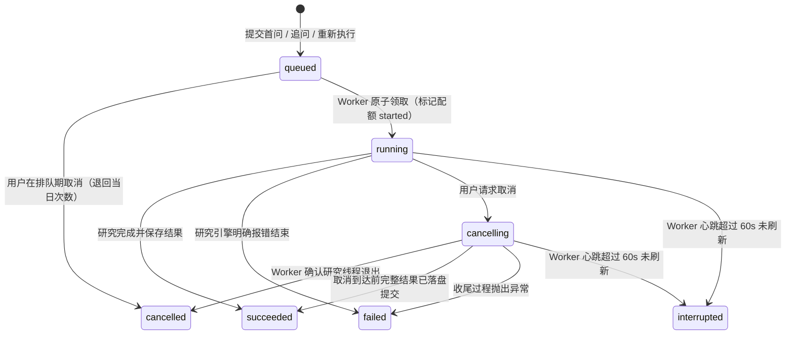

# 阶段 3：Worker 与进度推送

- 状态：草稿（合并即接受）
- 日期：2026-11-28
- 作者：用户 / Antigravity
- 关联：[#82](https://github.com/yy2511/deep-research-agent/issues/82)、[ADR 0002](../adr/0002-postgres-task-queue.md)、[ADR 0006](../adr/0006-sqlalchemy-alembic-sync.md)、[ADR 0009](../adr/0009-platform-roles-and-user-quotas.md)、[ADR 0010](../adr/0010-event-file-and-pg-notify.md)、[后端扩展总体方案](后端扩展总体方案.md) §3–§10、[阶段1-数据库与用户](阶段1-数据库与用户.md)、[阶段2-公开试用](阶段2-公开试用.md)

## 目标与不做什么

**做完后用户能感受到**：

1. **人多时自动排队，不再直接报错赶客**：同时运行的研究满员时，新提交的研究进入“排队中”，前面跑完自动开始。
2. **关网页、刷新、重启 API 服务都不丢研究**：研究在独立的 Worker 进程里跑；刷新网页或重启 API 容器后，实时进度自动从上次收到的位置无缝续上。
3. **异常中断清清楚楚，支持一键重新执行**：Worker 进程若因崩溃或机器重启失联，研究状态标为“已中断”（保留已存证据卡），不再混同于“执行出错”；用户可点“重新执行”，因平台进程中断导致的首次重试免费，不额外扣当日次数。
4. **取消真实可信**：排队中的任务点取消立即取消并退回当日次数；运行中的任务点取消先显示“取消中”，等后台研究线程真正退出后才标为“已取消”并释放并发名额。

研究引擎（`src/dra/research.py` `run_minimal_research`）的检索、阅读、子 Agent、存证与交稿合同保持不变。

**不做**：

- **断点续跑（checkpoint resume）**：中断后“重新执行”是新建一次 `run_attempt` 从头跑，不从半截模型上下文恢复（见 [EXPERIMENT_PLAN.md](../../EXPERIMENT_PLAN.md)）。
- **自动后台重跑**：外部大模型与付费搜索调用无法撤销计费，进程失联后绝不静默自动重跑。
- **引入 Kafka、RabbitMQ 或 Redis**：队列与通知全部基于现有 PostgreSQL（ADR 0002、ADR 0010）；Redis 留待第 4 阶段单独评估。
- **跨多台机器无共享目录部署**：API 与 Worker 在同一台机器上共享 `/data` 数据目录（ADR 0010）。
- **对多用户开放线上运行代码与浏览器扩展**：隔离边界维持阶段 2 现状。

## 现状

| 环节 | 现在的做法 | 代码位置 | 问题 |
| --- | --- | --- | --- |
| 执行研究 | 在 Web 进程事件循环里 `run_in_executor` 开后台线程跑 | `src/dra/api/services/runs.py` `RunRegistry._run_simple` | 重启 Web 容器即中断所有正在跑的研究 |
| 并发控制 | 进程内 `DRA_MAX_ACTIVE_RUNS` 与 `admission_lock`，超出直接抛 429 | `src/dra/api/services/runs.py` `start_simple_research` | 满员直接拒单，不能排队；开不了第二个进程 |
| 任务表 | 只记用户归属与对话关联，不存状态、配置快照或幂等键 | `src/dra/db_tables.py` `ResearchTask`、`RunAttempt` | 运行状态全靠本地 `meta.json` 和进程内存 |
| 追问并发去重 | 先在事务里读已登记集合 `counted`，出事务后再进内存判断重复与最新轮 | `src/dra/api/services/runs.py` `start_owned_followup` | 存在先检查后行动竞争，并发重叠追问可能跑两次（[#40](https://github.com/yy2511/deep-research-agent/issues/40)） |
| 实时进度流 | 订阅 `RunHandle.buffer` 与内存 `asyncio.Queue` | `src/dra/api/services/runs.py` `follow_events` | 不在当前进程内存就报 404，无法跨进程推送或续接 |
| 取消与插话 | 直接操作内存里的 `threading.Event` 与 `ResearchInput` 对象 | `src/dra/api/services/runs.py` `cancel`、`post_message`；`src/dra/research_input.py` | 拆出 Worker 后 API 进程碰不到 Worker 内存对象 |
| 启动孤儿清理 | Web 启动时扫描全部 `runs/*/meta.json`，把 `running` 一律改成 `failed` | `src/dra/api/app.py` `_lifespan`；`src/dra/runstore.py` `mark_orphans` | Web 重启会误标 Worker 正在正常执行的任务，且把“进程中断”混成“执行报错” |
| 生产编排 | 单个 `web` 容器承担全部职责 | `deploy/compose.production.yaml`、`deploy/container_release.py` | 尚无 `worker` 服务定义与协同发布流程 |

## 方案

### 1. 数据模型（迁移 `0007`）

在阶段 1 已建好的 `research_tasks`、`run_attempts` 两张表上扩充字段，并新增 `run_messages` 表承载跨进程运行中补充消息。迁移脚本只操作数据库，不依赖扫描磁盘 `runs/` 目录；所有时间列使用带时区的 `UTCDateTime`（ADR 0006）。

#### 1.1 `research_tasks`（用户的一次研究请求：首问或追问）

| 新增/调整字段 | 类型与约束 | 说明 |
| --- | --- | --- |
| `turn_index` | `Integer`，非空；唯一约束 `(conversation_id, turn_index)` | 对话内轮次序号（首问为 1，追问递增），从数据库层面根治并发追问同序号竞争（#40） |
| `status` | `String(16)`，非空，检查约束见 §2.1 | 当前平台执行状态（跟随最新一次 `run_attempts`） |
| `idempotency_key` | `String(64)`，可空；唯一索引 `(user_id, idempotency_key)` | 提交幂等键：首问由前端生成传入，追问复用 `request_id`；历史旧记录为空 |
| `request_fingerprint` | `String(64)`，可空 | 请求核心参数的 SHA-256 摘要；同一 `idempotency_key` 带不同内容重试时返回 `409` |
| `config_snapshot` | `Text`（JSON），可空 | 入队时固定的执行配置快照（已解析的 `SimpleConfig`、初始 `requirements`、`brief`、`followup_context`、`full_llm_io`、`is_guest`）。**不含任何 API Key 明文**（连接凭据仍在运行时由 Worker 从受控环境读取） |
| `current_run_id` | `String(64)`，可空，索引 | 当前生效（最新一次）尝试的 `run_id`，供列表、对话链与追问定位父轮次 |
| `free_interrupted_retries_used` | `Integer`，默认 `0`，`>= 0` | 已使用的“进程中断免费重试”次数（上限 1 次，见 §3.2） |
| `cancel_requested_at` | `UTCDateTime`，可空 | 用户点击取消的时间 |
| `updated_at` | `UTCDateTime`，非空 | 状态最后更新时间；建索引 `(status, created_at)` 供 Worker 按序抢单 |

#### 1.2 `run_attempts`（一次实际执行，对应 `runs/<run_id>/` 目录）

一次 `research_tasks` 初次入队时同步创建 `attempt_no = 1` 的 `run_attempts` 并分配 `run_id`；只有点“重新执行”时才在同一 `task_id` 下新增 `attempt_no = 2, 3...`（各自拥有独立的新 `run_id` 和运行目录，旧目录与旧记录完整保留）。

| 新增/调整字段 | 类型与约束 | 说明 |
| --- | --- | --- |
| `attempt_no` | `Integer`，非空，默认 `1`；唯一约束 `(task_id, attempt_no)` | 第几次执行尝试 |
| `retry_of_run_id` | `String(64)`，可空 | 若为手动重试，记录被重试的那次 `run_id`，便于界面和审计追溯 |
| `status` | `String(16)`，非空，检查约束同 `research_tasks.status` | 本次尝试的平台状态 |
| `delivery_status` | `String(16)`，可空 | 引擎收尾后的结果分类（`done` / `partial` / `failed` / `cancelled`），与 `meta.json` 一致 |
| `worker_id` | `String(128)`，可空 | 领取本次尝试的 Worker 实例标识（如 `<hostname>:<pid>:<uuid8>`） |
| `heartbeat_at` | `UTCDateTime`，可空；索引 `(status, heartbeat_at)` | Worker 最近一次心跳时间（`running` / `cancelling` 期间定期刷新） |
| `started_at` | `UTCDateTime`，可空 | Worker 实际领取开跑的时间 |
| `finished_at` | `UTCDateTime`，可空 | 进入终态的时间 |
| `error` | `Text`，可空 | 失败或中断原因摘要（脱敏，不含密钥或上游原始凭证） |
| `last_event_seq` | `Integer`，非空，默认 `-1` | 已完整刷入 `events.jsonl` 的最大事件序号（`-1` 表示尚无事件，见 ADR 0010） |
| `input_state` | `String(16)`，非空，默认 `'open'` | 补充消息收件箱状态：`open` / `closing` / `closed` |
| `input_revision` | `Integer`，非空，默认 `0` | 补充消息修订号，用于与引擎交稿封口 `seal()` 原子比对 |

#### 1.3 `run_messages`（运行中用户补充消息）

| 字段 | 类型与约束 | 说明 |
| --- | --- | --- |
| `id` | `BigId` 主键 | 自增编号 |
| `attempt_id` | 外键 `run_attempts.id`，非空，索引 | 所属执行尝试 |
| `message_id` | `String(100)`，非空；唯一约束 `(attempt_id, message_id)` | 前端生成的消息幂等 ID |
| `revision` | `Integer`，非空；唯一约束 `(attempt_id, revision)` | 该尝试内的递增序号（从 1 开始） |
| `text` | `Text`，非空 | 用户补充正文（1–6000 字符，单次运行累计 `<= 60000` 字符，沿用现役边界） |
| `status` | `String(16)`，非空，`queued / included / undelivered` | 消息投递状态 |
| `call_id` | `String(128)`，可空 | 实际带入哪一次主线模型请求 |
| `reason` | `Text`，可空 | 未投递（`undelivered`）时的原因说明 |
| `created_at` | `UTCDateTime`，非空 | 接收时间 |

#### 1.4 存量数据迁移回填规则

迁移 `0007` 在已有库上执行时：
- 按 `(conversation_id, created_at, id)` 顺序用窗口函数或分组查询为存量 `research_tasks` 回填递增的 `turn_index`，并把 `current_run_id` 填为关联的 `run_attempts.run_id`。
- 存量记录都是在服务停止维护窗口前已落库的旧运行：`status` 回填为 `'succeeded'`，`attempt_no = 1`，`input_state = 'closed'`，`delivery_status` 保持 `NULL`（历史列表展示时若 `delivery_status IS NULL` 则继续读取既有 `meta.json.status`，不把历史失败运行谎报为成功）。
- 存量记录 `config_snapshot` 为 `NULL`；若用户对迁移前的旧失败记录调用 `retry`，优先尝试从 `meta.json` 的 `resolved_config` 恢复，若无完整配置则返回 `409 该历史记录早于后台队列版本，缺少执行快照，请直接新建研究`。

---

### 2. 任务生命周期与并发协调

#### 2.1 七个平台状态

| 平台状态 | 含义 | 是否占用执行槽位 / 未结束任务数 |
| --- | --- | --- |
| `queued` | 已入队，等待空闲 Worker 领取 | 计入该用户的未结束任务；**不占** Worker 执行槽位 |
| `running` | Worker 已领取，正在执行研究引擎 | 占用 Worker 执行槽位 |
| `cancelling` | 用户已请求取消，等待 Worker 内的研究线程安全退出 | **仍占用** Worker 执行槽位（直到线程真正退出才释放） |
| `succeeded` | 研究引擎正常结束并落盘结果（具体报告是完整 `done` 还是受限 `partial` 见 `delivery_status`） | 否（终态） |
| `failed` | 研究引擎捕获明确错误结束，或交付状态为 `failed` | 否（终态） |
| `cancelled` | 排队期直接取消，或 Worker 确认研究线程已按取消退出 | 否（终态） |
| `interrupted` | Worker 进程心跳超时失联，未能正常结算 | 否（终态） |



#### 2.2 提交、幂等与追问去重（含修复 #40）

1. **首问入队（`POST /api/research`）**：
   - 接收可选 `idempotency_key`（前端每次新点发送时自动生成 UUID；旧脚本未传时服务端每次视为独立新请求）。
   - 在同一个短事务内：
     1. 按既有锁序（`quotas.begin_write` → 治理行 → `users` 行 `FOR UPDATE`）读取当前有效角色与配额策略；
     2. 若传了 `idempotency_key`，查 `(user_id, idempotency_key)`：已存在且 `request_fingerprint` 相同则直接返回原任务（不重复扣费、不新建行）；指纹不同抛 `409 同一幂等键对应的请求内容不同`；
     3. 若为访客（`guest`），检查该用户当前是否存在 `status IN ('queued', 'running', 'cancelling')` 的任务，已有则抛 `429 你已经有一个研究在排队或进行中，请等它结束后再问`；
     4. 校验资料库版本固定、MCP 与来源参数，构造脱敏 `config_snapshot`；
     5. 调用 `quotas.reserve_in_session` 扣减当日次数（记 `QuotaReservation.state = 'reserved'`）；
     6. 写入 `conversations`、`research_tasks`（`status = 'queued'`、`turn_index = 1`）、`run_attempts`（`attempt_no = 1`、`status = 'queued'`），并在 `runs/<run_id>/meta.json` 写入初始 `status = "queued"` 元数据（保证列表与详情接口在排队期即可按统一格式读取）；
     7. 执行 `NOTIFY dra_tasks, 'queued'` 后提交事务，HTTP 返回 `202 Accepted`（含 `run_id`、`task_id`、`status: "queued"`）。

2. **追问入队（`POST /api/research/{run_id}/followup`）**：
   - 在同一个短事务内锁住 `Conversation` 行（`SELECT ... FOR UPDATE`）：
     1. 校验归属与公开示例冻结（`Showcase` 存在则 `409`）；
     2. 查该对话下是否已有 `idempotency_key == request_id` 的任务：若有且父轮次与正文指纹一致，直接幂等返回该轮信息；不一致返 `409`；
     3. 查该对话最新一轮 `research_tasks`（按 `turn_index DESC LIMIT 1`）：若 `current_run_id != parent_run_id`，返 `409 研究已有新一轮，请回到最新一轮继续`；若最新一轮 `status IN ('queued', 'running', 'cancelling')`，返 `409 上一轮仍在排队或运行中，请结束后继续追问`；
     4. 扣减当日研究次数，插入 `turn_index = latest.turn_index + 1` 的新任务与首次尝试（状态 `queued`），`NOTIFY dra_tasks, 'queued'`。
   - **为什么这彻底修好了 #40**：以前“查已有轮次”在数据库事务里，而“判断是否重复、是否最新一轮”在事务外的内存里；现在这两步合并进同一个持有 `Conversation` 排他行锁的事务，且有 `(conversation_id, turn_index)` 唯一约束兜底，两个并发追问绝不可能同时通过。

#### 2.3 Worker 抢单领取与访客槽位保护

Worker 进程维护本地线程池（容量由环境变量 `DRA_WORKER_CONCURRENCY` 控制，默认 `2`）。每当有空闲槽位时，开启毫秒级短事务领取一条任务：

```sql
-- PostgreSQL：跳过其他 Worker 正在锁定的行，不阻塞等待
SELECT rt.id
FROM research_tasks rt
JOIN users u ON u.id = rt.user_id
WHERE rt.status = 'queued'
  AND (
    u.role != 'guest'
    OR (
      SELECT COUNT(*) FROM research_tasks g
      JOIN users gu ON gu.id = g.user_id
      WHERE gu.role = 'guest' AND g.status IN ('running', 'cancelling')
    ) < :max_concurrent_guest_runs
  )
ORDER BY rt.created_at ASC, rt.id ASC
FOR UPDATE OF rt SKIP LOCKED
LIMIT 1;
```

- **访客槽位保护**：当全站正在运行的访客任务已达 `trial.max_concurrent_guest_runs`（如线上设为 `1`，而 Worker 总并发为 `2`）时，排队中的其他访客任务保持 `queued` 等待，Worker 会自动跳过它们优先执行管理员或普通用户的任务，既让访客能排队，又保留阶段 2“不让访客占满全部执行槽位”的保护。
- **SQLite 测试兼容**：SQLite 不支持 `SKIP LOCKED`，在 `quotas.begin_write`（`BEGIN IMMEDIATE`）串行写事务下执行同一筛选逻辑，语义等价。
- **同一领取事务内**：将 `research_tasks.status` 与 `run_attempts.status` 改为 `'running'`，填 `worker_id`、`started_at = now`、`heartbeat_at = now`，并将对应 `QuotaReservation.state` 更新为 `'started'`（此后不再退回次数）。事务提交后，在事务外启动研究引擎。

#### 2.4 取消与完成的条件更新竞争

1. **排队期取消**：API 执行条件更新 `UPDATE research_tasks SET status = 'cancelled', cancel_requested_at = :now WHERE id = :tid AND status = 'queued'`。若命中，同事务把 `run_attempts` 标为 `'cancelled'`、`input_state = 'closed'`，调用 `quotas.refund_in_session` **原路退回当日次数**，更新 `meta.json` 并 `NOTIFY dra_events`。
2. **运行期取消**：若上述排队期更新未命中且当前状态为 `'running'`，API 将 `research_tasks` 与 `run_attempts` 更新为 `'cancelling'`、记录 `cancel_requested_at`，将 `input_state` 置为 `'closed'`（把尚未投递的 `queued` 补充消息标为 `undelivered`），并发出 `NOTIFY dra_tasks, 'cancel:<run_id>'`。
3. **Worker 感知与终态结算**：
   - Worker 监听到 `dra_tasks`（或每数秒随心跳轮询一次当前尝试的 `status`），发现变为 `'cancelling'` 即置位本地 `cancel_event.set()`，协作式通知研究引擎停止；
   - 研究线程真正退出后，Worker 执行条件终态写入（`WHERE status IN ('running', 'cancelling')`）：
     - 若研究引擎已完成有效结果落盘（`stop_reason != 'cancelled'` 且结果已写入 `simple.json`），即使此前刚被置为 `'cancelling'`，仍按真实结果写入 `'succeeded'`（或 `'failed'`），不丢弃已完成的报告；
     - 若引擎因取消退出（`stop_reason == 'cancelled'`），写入 `'cancelled'`，此时 Worker 才释放本地并发槽位并继续领下一单。

---

### 3. 配额扣退与手动重新执行（Retry）

按已确认规则，配额与重试口径汇总如下：

| 场景 | 当日免费次数处理 | 说明 |
| --- | --- | --- |
| 提交入队（`queued`） | 立即扣减 1 次（`QuotaReservation = reserved`） | 防止额度只剩 1 次时连点排入多条任务 |
| 在 `queued` 期间取消 | **退回 1 次**（`QuotaReservation = refunded`） | 尚未占用 Worker 执行、未产生任何模型与搜索费用 |
| 进入 `running` 后取消 / 报错 / 中断 | 不退回（`QuotaReservation = started`） | 已开始实际调用外部服务 |
| 因 `interrupted`（平台进程失联）点“重新执行” | **第 1 次免费**（不扣个人与全站池次数） | 平台故障导致中断，补偿 1 次机会；同一任务若连续第 2 次仍 `interrupted` 再重试则按新一次扣减，防毒丸任务无限免费重跑 |
| 因 `failed`（引擎明确报错）点“重新执行” | **按新一次研究扣减 1 次** | 原尝试已完整走过执行与重试；新尝试在 `queued` 期间取消同样可退 |

**重新执行接口（`POST /api/research/{run_id}/retry`）约束**：
- 请求体：`{ "idempotency_key": "<客户端生成>" }`，挂 `OWNED_RUN`（仅本人可操作，公开示例对话冻结期返 `409`）。
- 只允许针对以下条件发起重试，否则返回 `409`：
  1. `run_id` 是所属 `research_tasks` 的最新一次尝试（`current_run_id == run_id`），且该任务当前没有正在排队或运行的尝试；
  2. 该尝试状态为 `'interrupted'` 或 `'failed'`；
  3. 该任务是所属 `Conversation` 的最新一轮（避免重跑历史中间轮次后与后续已生成的追问上下文自相矛盾）。
- 重试在同一 `research_tasks` 下插入 `attempt_no + 1` 的新 `run_attempts`（分配新 `run_id`，记录 `retry_of_run_id`），复用原任务的 `config_snapshot`（但按当前时刻校验用户未被停用；若用户已降级为 `guest` 而原快照含私域资料库或 MCP，明确拒绝并返回 `403/409`），更新 `research_tasks.current_run_id = new_run_id`、`status = 'queued'`，并通知 Worker 领取。

---

### 4. 跨进程补充消息、心跳巡检与优雅停机

#### 4.1 跨进程运行中补充消息（`WorkerResearchInput`）

为保持 `EXPERIMENT_PLAN.md` 中“用户中途插话与交稿封口在同一把锁内排序”的不变式，同时遵守 ADR 0010“Worker 是 `events.jsonl` 唯一写者”：

1. **API 接收（`POST /api/research/{run_id}/messages`）**：
   - 在数据库短事务中 `SELECT ... FOR UPDATE` 锁住 `RunAttempt` 行：
     - 若 `(attempt_id, message_id)` 已存在：正文相同则幂等返回已接收结果，正文不同返回 `409`；
     - 若尝试状态为 `'queued'`，返回 `409 研究尚在排队，开始运行后可发送补充消息`；
     - 若尝试已非 `'running'` 或 `input_state != 'open'`，返回 `409 研究正在收尾或已结束，未接收新消息`；
     - 校验单条 1–6000 字符、该尝试累计补充消息总长度 `<= 60000` 字符（沿用现役边界，不新增截断）；
     - `input_revision += 1`，插入 `run_messages`（`status = 'queued'`），执行 `NOTIFY dra_tasks, 'msg:<run_id>'` 后提交事务，返回 `202`。
2. **Worker 消费与封口**：
   - Worker 为研究引擎注入实现相同方法签名（`announce`、`begin_request`、`seal`、`stop_receiving`、`close`、`pending`）的 `WorkerResearchInput`：
     - 收到 `msg:<run_id>` 通知时，置位本地 `pending.set()` 立即唤醒正在 `wait_research` 的主 Agent，并将新增消息追加为 `events.jsonl` 中的 `research_input(kind='accepted')` 事件；
     - 主 Agent 每次发起模型请求前调用 `begin_request(call_id)` 时，在数据库事务内锁住 `RunAttempt` 行，领取全部 `status = 'queued'` 的 `run_messages` 标为 `'included'`，写出 `research_input(kind='included')` 事件；
     - 主 Agent 调用 `finish_research` 触发 `seal(revision)` 时，同样在 `RunAttempt` 行锁下核对数据库中的 `input_revision`：若用户在最后一刻刚提交了新消息（`attempt.input_revision != revision`），`seal()` 返回 `False` 挡回本次交稿，让主 Agent 先读新消息再决定如何收尾——与单进程内存锁的行为完全一致。
3. **只读查询快照**：`GET /api/runs/{run_id}` 中的 `research_input` 优先从 `run_messages` + `run_attempts.input_state` 组装（刚提交尚未被 Worker 写进 `events.jsonl` 的消息也能立即看到），没有库表记录的旧运行回退走 `replay_input(events.jsonl)`。

#### 4.2 心跳与中断识别（`interrupted`）

- **默认参数**（均可由环境变量覆盖，离线测试可设为百毫秒级加速验证）：
  - 心跳间隔 `DRA_HEARTBEAT_INTERVAL_S = 10` 秒；
  - 中断判定阈值 `DRA_HEARTBEAT_TIMEOUT_S = 60` 秒。
- **独立心跳刷新**：因为研究引擎单次同步工具或模型调用可能耗时数十秒，Worker 进程内由独立守护线程每 10 秒统一为本进程仍在活跃运行的 `run_attempts` 刷新 `heartbeat_at = now`（顺带读回数据库中的 `status` 与 `input_revision`，作为 `NOTIFY` 之外的兜底同步）。若某次尝试发现自身在库里的状态已被外部判为 `interrupted`（例如极端宿主机卡顿导致租约丢失），立即置位本地 `cancel_event` 停止后续外部调用，且不再覆盖库中终态。
- **超时回收巡检**：
  - Worker 主循环每 15 秒执行一次回收扫描，API 进程的 `/healthz` 或列表读取路径也可按节流间隔（如每 30 秒至多一次）触发同一幂等回收函数（保证即使所有 Worker 容器都挂死，用户打开页面也能在 60 秒后看到任务变为 `interrupted`，不会永久转圈）：
  - 查找 `status IN ('running', 'cancelling') AND heartbeat_at < now - 60s` 的尝试，锁行后更新 `run_attempts` 与 `research_tasks` 为 `status = 'interrupted'`、`input_state = 'closed'`、未投递消息标为 `undelivered`，同步更新 `meta.json`（若存在）并发出 `NOTIFY dra_events`。
- **移除 Web 启动时的盲目 `mark_orphans()`**：API 容器启动时不再扫描 `runs/*/meta.json` 把所有 `running` 改成 `failed`（`app.py` `_lifespan`），避免重启 API 容器时误伤 Worker 正在跑的任务。

#### 4.3 Worker 进程入口与优雅停机

- 新增启动入口 `python -m dra.worker`（`src/dra/worker/`）：启动时与 API 一样执行 `db.check_ready()`（数据库未配置或迁移不是最新时拒绝启动），并初始化执行沙箱池清理（原本挂在 `app.py` `_lifespan` 里的 `reap_orphans` / `shutdown_pools` 迁到实际运行研究的 Worker 生命周期中）。
- **优雅停机（`SIGTERM` / `SIGINT`）**：
  1. 收到停机信号后，Worker 立即将自身标记为 `draining`，不再从数据库领取任何新 `queued` 任务；
  2. 若当前没有在跑任务，立即退出；若有在跑任务，在配置的优雅等待期（`DRA_WORKER_SHUTDOWN_GRACE_S`，生产 Compose 默认设为 `120s`，也可按需调整）内继续维持心跳，等在跑任务自然完成交稿后退出；
  3. 若到达优雅等待上限仍未结束，置位 `cancel_event`、停止心跳并退出，未完成的尝试按中断流程收敛为 `interrupted`。

---

### 5. 进度事件推送与断线续传（ADR 0010）

`GET /api/research/{run_id}/stream` 升级为跨进程文件 + 数据库通知流（保持 `READABLE_RUN` 权限：本人或公开示例可读）：

1. **续传参数**：同时支持查询参数 `after_seq: int = -1` 与标准 SSE 请求头 `Last-Event-ID`（两者都传时取较大值，默认 `-1` 即从第 `0` 条开始）。
2. **连接生命周期（不长期占用数据库连接池）**：
   - API 进程在启动生命周期内维护一个进程级事件广播器 `EventHub`：PostgreSQL 下由单条专用后台连接执行 `LISTEN dra_events`，收到 `<run_id>:<seq>` 后在进程内唤醒订阅了该 `run_id` 的所有 `asyncio.Queue`；SQLite 或专用连接重连期间，由固定短间隔（测试 50 ms / 生产兜底 2 s）触发检查。每个浏览器的 SSE 请求**不持有数据库连接**（遵守 ADR 0006 规则 5）。
3. **各状态下的推送行为**：
   - **`queued`（排队中）**：连接建立后先发送一条合成状态帧（或初始落盘的排队状态事件 `{"type": "research_status", "mode": "simple", "phase": "queued", ...}`），保持连接挂起；一旦 Worker 领取开跑写入真实事件，同一条 SSE 连接自动接着往下推，前端无需断开重连。
   - **`running` / `cancelling`**：先从 `events.jsonl` 顺序读出 `after_seq < seq <= attempt.last_event_seq` 的所有事件补发给客户端，随后挂起等待 `EventHub` 唤醒增量读取，直到读到 `type == "end"` 事件后正常关闭流。
   - **已处于终态（`succeeded` / `failed` / `cancelled` / `interrupted`）**：从 `events.jsonl` 补发 `seq > after_seq` 的全部已确认事件；若尝试因 `interrupted` 猝死导致文件末尾缺少 `end` 事件，API 在补发完已有事件后追加一条合成的 `interrupted` 错误提示帧与 `end` 帧结束流，让前端明确收束状态而不再死等。

---

### 6. 接口与前端变化

#### 6.1 接口变化汇总

| 接口 | 变化说明 |
| --- | --- |
| `POST /api/research` | 请求体新增可选 `idempotency_key: str | None`；成功返回 **HTTP `202`** `{ "run_id": "...", "task_id": 12, "status": "queued", "mode": "simple" }` |
| `POST /api/research/{run_id}/followup` | 返回 `202`（含 `status: "queued"`）；在 `Conversation` 行锁内原子完成重复提交检查与最新轮次校验（关闭 #40） |
| `POST /api/research/{run_id}/retry` | **新增**：请求 `{ "idempotency_key": "..." }`，对最新一轮处于 `interrupted` 或 `failed` 的尝试发起重新执行，返回 `202` `{ "run_id": "<新run_id>", "retry_of_run_id": "<旧run_id>", "attempt_no": 2, "status": "queued", "quota_charged": false }` |
| `POST /api/research/{run_id}/cancel` | 支持取消 `queued`（直接变 `cancelled` 并退回次数）或 `running`（变 `cancelling` 并通知 Worker）；已是终态时幂等返回当前终态 |
| `POST /api/research/{run_id}/messages` | 改为写入 `run_messages` 并通知 Worker；`queued` 期返回 `409` 提示开跑后再发 |
| `GET /api/research/{run_id}/stream` | 支持 `after_seq` 与 `Last-Event-ID`；运行不在本进程内存也可订阅（含排队中、运行中、重启后重连） |
| `GET /api/runs`、`GET /api/conversations`、`GET /api/runs/{run_id}` | 结合数据库任务/尝试表返回权威平台 `status`（`queued / running / cancelling / interrupted / ...`）、`attempt_no`、`retry_of_run_id`、`can_retry` 与免费重试标记；某轮次存在多次尝试时，对话主链展示 `current_run_id`，详情接口附带历史 `attempts` 简要列表供回看旧证据 |
| `GET /healthz` | 保持检查 Web 响应、持久目录可写与数据库 `SELECT 1`；附带队列中 `queued_runs`、`active_runs` 计数摘要 |

#### 6.2 前端变化

1. **防重幂等键**：前端点击“开始研究”或“重新执行”时生成 UUID 作为 `idempotency_key`；网络超时原地重试时复用同一 key，用户主动改词或新开提问时生成新 key。
2. **状态展示**：
   - **排队中（`queued`）**：侧边栏与工作区顶部显示“排队中 · 前方任务完成后自动开始”，提供“取消排队”按钮（提示取消后退回本次额度），隐藏运行中才可用的“补充消息”输入框；
   - **取消中（`cancelling`）**：取消按钮禁用并显示“正在停止后台研究…”，直到收到结束事件变为“已取消”；
   - **已中断（`interrupted`）**：用区别于普通报错的醒目提示条说明“后台研究进程意外中断，已保存的证据卡仍可查看”，并在最新一轮提供“重新执行”按钮（首次中断显示“免费重新执行”，其余需要扣次数的重试显示“重新执行（消耗 1 次今日额度）”）。
3. **SSE 断线续传**：前端 `EventSource`（或流式读取器）记录已收到的最大 `seq`，连接意外断开重连时附带 `?after_seq=<lastSeq>`，不重复清空画面、不漏中间步骤。

---

### 7. 部署与容量评估

2026-11-28 对线上服务器 `kc-edge-01` 的只读采样：
- 主机 2 核 CPU、**1.9 GiB 物理内存（当前可用 `available` 838 MiB）**、2.0 GiB Swap（剩余 1.1 GiB），50 GB 磁盘剩余 19 GB；
- 现有 `deep-research-agent-web-1` 常驻内存 **41.3 MiB**（刚启动峰值约 126 MiB），`postgres:16` 常驻 **24.7 MiB**，同机其余 3 个容器合计 **62.6 MiB**。

**编排调整（第 5 步实施）**：
- `deploy/compose.production.yaml` 使用同一个不可变镜像 `ghcr.io/yy2511/deep-research-agent:sha-<40位SHA>` 定义两个服务：
  - `web`：对外绑定 `127.0.0.1:8765:8765`，不跑研究线程；
  - `worker`：`command: ["python", "-m", "dra.worker"]`，**不发布任何端口**，挂载同一 `/data` 与数据库网络，`DRA_WORKER_CONCURRENCY=2`、`stop_grace_period: 120s`。
- 多加 1 个 `worker` 容器预计增加约 100～150 MiB 常驻内存，在 838 MiB 可用内存范围内安全可承载。
- `deploy/container_release.py` 更新 `verify`、`activate`、`status`、`rollback`：同时检查 `web` 健康与 `worker` 运行状态（`running`、restart count 未增长、OOM false）。

## 出错时怎么办

| 异常情况 | 系统处理 |
| --- | --- |
| 同一请求因网络抖动重复发送（同一 `idempotency_key`） | 唯一约束拦住重复创建，直接返回已有任务与 `run_id`，不重复扣次数 |
| 两个 Worker 同时空闲抢同一条 `queued` 任务 | `FOR UPDATE SKIP LOCKED` 保证只有一个领走，另一个直接领下一条或空手返回 |
| 重启 API 容器（如发布前端或接口改动） | Worker 容器不受影响继续跑；浏览器 SSE 短暂断开后带 `after_seq` 重连新 API，从 `events.jsonl` 补齐断开几秒内的事件 |
| Worker 进程因 OOM 或宿主机故障猝死（`SIGKILL`） | `heartbeat_at` 超过 60 秒未更新，巡检将其标为 `interrupted`、关闭未投递消息；已落盘的来源与证据卡保留，用户可免费“重新执行” 1 次 |
| 用户点取消的同一瞬间 Worker 刚好完成交稿 | 条件更新按先后落库：若完整结果已落盘，终态记 `succeeded`，不白丢报告；若取消先让引擎停手，终态记 `cancelled` |
| 用户在主 Agent 即将调用 `finish_research` 前一刻发补充消息 | 两者在 `RunAttempt` 数据库行锁上串行化：消息先入库则 `seal()` 看见新 `input_revision` 挡回交稿；`seal()` 先封口则新消息返 `409` |
| PostgreSQL `LISTEN` 长连接因网络闪断重连 | `EventHub` 自动重连并立即扫描一次数据库 `last_event_seq` 与状态，补发断连窗口内的所有事件，不丢进度 |
| 所有 Worker 都未启动或已挂停 | 新研究仍能正常入队 `queued`（页面显示排队中，用户随时可取消并拿回次数）；巡检在 API 侧也会把超时旧运行推进到 `interrupted` |

## 验收场景

| 场景 | 预期 |
| --- | --- |
| 并发提交相同 `idempotency_key`（首问、追问、重试） | 只创建一条任务/尝试，只扣一次额度；修改正文复用同一 key 返回 `409` |
| 同一对话并发发起两个不同追问（#40 回归） | 恰好一个成功入队，另一个返回 `409`，不会出现两个相同 `turn_index` |
| 并发提交超过 Worker 槽位数的多个研究 | 全部成功返回 `202`；前 N 个变为 `running`，其余为 `queued`，前序结束后自动依次执行 |
| 访客已有 1 个 `queued` 或 `running` 研究时再次提交 | 返回 `429` 提示等当前研究结束，不扣第二次额度；前一个结束后可提交第二个 |
| 访客研究排队超过 `max_concurrent_guest_runs`，后续管理员提交研究 | 访客并发槽满时，空闲槽位优先领走管理员的任务，管理员不被访客队列堵住 |
| 在 `queued` 状态点取消 | 立即变为 `cancelled`，个人与全站访客当日剩余次数加回 1 次 |
| 在 `running` 状态点取消 | 先变为 `cancelling` 且槽位仍占用；研究线程退出后变为 `cancelled` 并释放槽位，当日次数不退 |
| 模拟重启 API 实例（销毁旧 `app` 新建 `app`） | 正在跑的 Worker 不中断；客户端带 `after_seq` 重连新 API 后事件序号连续无缺漏、无重复 |
| 模拟强杀 Worker（停止心跳超过阈值） | 任务自动由 `running` 变为 `interrupted`；已保存证据卡仍可读；SSE 收到终止事件正常收束 |
| 对 `interrupted` 任务点“重新执行” | 第 1 次不扣当日次数，生成新 `run_id`（`attempt_no = 2`），旧 `run_id` 记录仍可回看；若第 2 次仍 `interrupted` 再重试则扣 1 次 |
| 对 `failed` 任务点“重新执行” | 扣减 1 次当日次数（次数用完时 `429`），新尝试在 `queued` 取消可退回 |
| 运行中发送补充消息，以及与交稿封口并发 | 消息进入下一轮模型上下文；交稿前刚入队的新消息能阻止旧交稿，封口后的消息返回 `409` |
| 默认 SQLite 与 `--run-postgres` 双环境全量测试 | 同一套业务测试均通过；PostgreSQL 下额外实测真实多线程 `SKIP LOCKED` 抢单与 `LISTEN/NOTIFY` 唤醒 |

## 新增的限制

**本次设计拟新增的限制**：
- **单机共享目录**：API 与 Worker 必须挂载同一宿主机数据目录（ADR 0010），暂不支持跨机器无共享盘部署。
- **访客未结束任务上限**：每个访客同一时间最多只能有 **1 个**未结束的研究（含 `queued`、`running`、`cancelling`），结束后才可发起下一个。
- **心跳与中断判定默认值**：Worker 默认每 **10 秒**更新一次心跳，超过 **60 秒**未更新判为 `interrupted`（可通过 `DRA_HEARTBEAT_INTERVAL_S`、`DRA_HEARTBEAT_TIMEOUT_S` 调整）。
- **中断免费重试上限**：同一研究任务因平台 `interrupted` 获得的免费重新执行机会上限为 **1 次**；再次中断后的重试或普通 `failed` 重试按正常规则消耗当日研究次数。
- **重试范围限制**：仅允许对对话最新一轮的最新一次失败/中断尝试执行 `retry`，不支持重跑历史中间轮次；阶段 3 之前缺少配置快照的旧历史记录不支持直接 `retry`。
- **排队期补充消息限制**：任务处于 `queued` 尚未开跑时暂不接收运行中补充消息（返回 `409`），进入 `running` 后开放。

**本次移除的限制**：
- 移除 Web 单进程全站 `DRA_MAX_ACTIVE_RUNS` 满员直接返回 `429` 拒单的限制，改为进入 `queued` 队列等待 Worker 按并发槽位（默认 `DRA_WORKER_CONCURRENCY=2`）依次领取。

**沿用且影响本流程的限制**：
- 访客每日个人/全站次数、仅允许网页来源、关闭运行代码与浏览器的限制不变（阶段 2、ADR 0009）。
- 单条补充消息 1–6000 字符、单次运行累计 60000 字符上限不变。
- 线上服务器暂不开启运行代码与私域资料库（见 [deployment.md](../deployment.md#当前未覆盖)）。

## 实施步骤

每一步独立建 issue、独立拉分支开 PR，前一步合并后再开始下一步：

| 步骤 | 范围 | 主要内容 | 依赖 |
| --- | --- | --- | --- |
| **1. 任务表迁移与入队状态机（3-1）** | 后端 + 数据库 | 迁移 `0007`（扩充 `research_tasks`、`run_attempts`，新建 `run_messages`，存量回填）；提交幂等与追问并发去重（关闭 #40）；排队期取消退回次数与 `retry` 配额台账逻辑；单元测试（SQLite + PG） | 本设计合并 |
| **2. Worker 进程、心跳与跨进程控制（3-2）** | 后端 | 新增 `src/dra/worker/`（`SKIP LOCKED` 抢单、访客槽位保护、独立心跳线程、超时 `interrupted` 巡检、优雅停机）；`WorkerResearchInput` 跨进程补充消息与取消联动；API 改为只入队不自跑研究，去掉 Web 启动 `mark_orphans` | 步骤 1 |
| **3. 跨进程 SSE 进度流与续传（3-3）** | 后端 | `last_event_seq` 批次刷新 + PG `LISTEN/NOTIFY`（`EventHub`）+ SQLite/断线轮询兜底；`/api/research/{run_id}/stream` 支持 `after_seq`、`Last-Event-ID`、`queued` 等待与 `interrupted` 收束 | 步骤 2 |
| **4. 前端排队、中断与重新执行（3-4）** | 前端 | 提交与重试携带 `idempotency_key`；侧边栏与工作区展示“排队中 / 取消中 / 已中断”；排队取消与中断/失败“重新执行”按钮及次数提示；SSE 断线按 `seq` 自动续接 | 步骤 2、3 |
| **5. 生产编排升级与上线（3-5）** | 部署 | `deploy/compose.production.yaml` 与 `container_release.py` 增加 `worker` 服务管理与健康检查；CI 镜像冒烟测试覆盖 API + Worker 协同；经用户逐项确认后切换线上服务器并实测负载内存 | 步骤 1–4 |

## 待定事项

| 事项 | 何时定 | 当前倾向 |
| --- | --- | --- |
| 高频事件合并刷新 `last_event_seq` 的窗口大小 | 步骤 3 实现时实测 | 50～100 ms（控制事件 `0 ms` 立即刷新） |
| 生产环境 Worker 优雅停机等待秒数 `stop_grace_period` | 步骤 5 部署配置时 | 120 秒（兼顾发版速度与常规收尾；超时走 `interrupted` + 免费重试兜底） |
| 管理员运营面板是否展示当前排队数 / 中断数 | 阶段 5 可观测性 | 阶段 3 先在 `/healthz` 提供基础队列计数，面板指标留待阶段 5 统一设计 |

## 实施记录

待各实现 PR 合并后补充。
